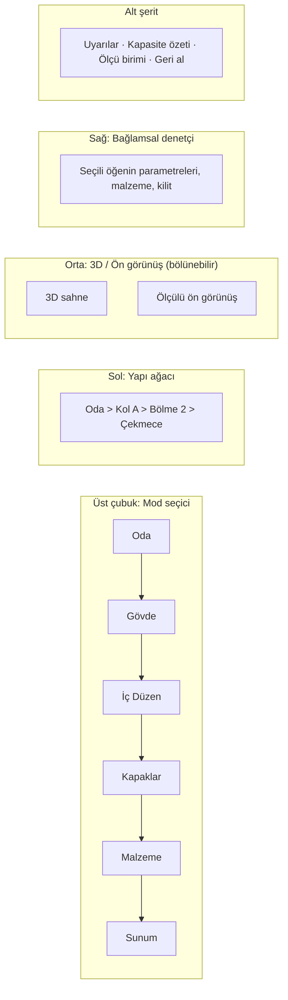
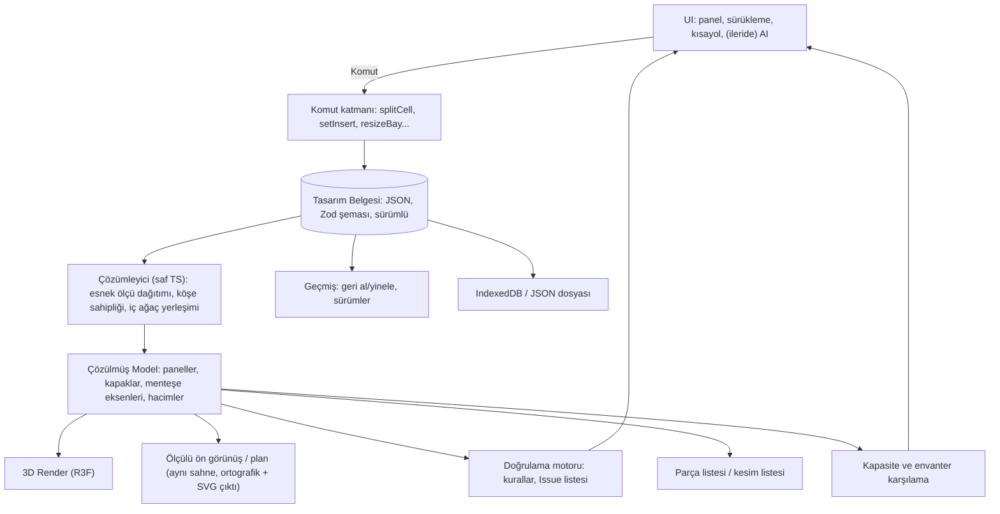
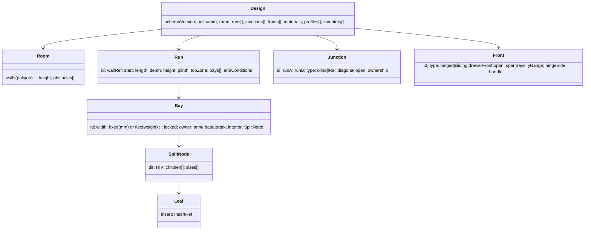
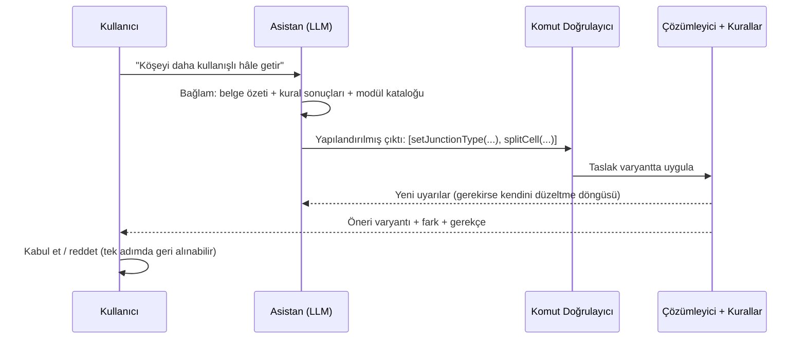
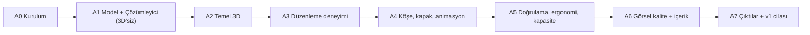

# Gardırop Tasarım Platformu — Bağımsız Araştırma ve Plan (Claude)

> Bu belge Gemini planı görülmeden, bağımsız olarak hazırlanmıştır. Kod içermez; yalnızca karar desteği amaçlı tip taslakları içerir.
> Tarih: 27.10.2026

---

## 0. Yönetici Özeti (Karar Verenler İçin 10 Madde)

1. **Ürünün kalbi 3D değil, "tasarım belgesi + çözümleyici"dir.** Gardırop; niyet bildiren bir JSON belgesi (ölçüler, esnek/sabit bölmeler, iç bölme ağacı) olarak tutulur. Saf bir TypeScript fonksiyonu bu belgeyi panellere, kapaklara ve uyarılara dönüştürür. 3D, 2D çizim, parça listesi ve gelecekteki yapay zekâ bu tek kaynaktan beslenir.
2. **Önerilen yığın:** TypeScript + Vite + React + React Three Fiber (R3F) + drei + Zustand/Immer + Zod. Sunucu yok; veriler tarayıcıda (IndexedDB) ve dışa aktarılabilir JSON dosyasında.
3. **İlk sürümde WebGPU değil WebGL kullanılmalı.** Sahne hafif (birkaç yüz kutu). drei ve postprocessing ekosisteminin WebGPU uyumluluğu hâlâ sorunlu. WebGPU, ölçülebilir bir fayda sağlamadan risk getirir.
4. **Fizik motoru da CSG (boolean) kütüphanesi de gerekmiyor.** Kapak ve çekmece hareketleri kinematik animasyonla yapılır; çakışmalar üstten görünüşte (2D) analitik olarak hesaplanır. Beşgen köşe rafları gibi özel biçimler poligon ekstrüzyonuyla üretilir.
5. **Hassas düzenleme 2D ön görünüşte, anlama ve doğrulama 3D'de yapılır.** Aynı sahne ortografik kamerayla "ölçülü ön görünüş" moduna geçer. Ayrı bir 2D motoru gerekmez; maliyet düşer, kullanılabilirlik artar.
6. **Genişletilebilirlik "Kol + Birleşim" (Run + Junction) grafiğiyle sağlanır.** Düz dolap 1 kol, L dolap 2 kol ve 1 köşe, U dolap 3 kol ve 2 köşedir. İlk günden U'yu destekleyen bir veri modeli kurulur, ancak arayüzü yazılmaz.
7. **İç düzen özyinelemeli bir bölme ağacıyla tanımlanır.** Yaprak düğümlere eklenti kaydından (registry) seçilen modüller takılır: raf, askı, çekmece, ayakkabılık, ütü masası nişi vb. Yeni bir modül türü eklemek tek bir dosya eklemek anlamına gelir.
8. **En güçlü inovasyon önerim: Envanter odaklı tasarım.** Kullanıcı sahip olduğu eşyaları girer (ör. "30 gömlek, 8 mont, 20 çift ayakkabı, ütü masası, 4 valiz"). Uygulama tasarımın bunları karşılayıp karşılamadığını kategori bazında canlı gösterir. Anne ve baba için iki kişilik ergonomi profili ve sahiplik renklendirmesi de bu senaryoya özel, düşük maliyetli ama yüksek faydalı özelliklerdir.
9. **İlk sürümde uygulama içinde yapay zekâ çalışmaz.** Ama mimari hazır olur: tüm düzenlemeler tiplenmiş **komutlar** üzerinden yapılır. Gelecekteki asistan da aynı komutları önerir; doğrulayıcıdan geçer ve kullanıcı onayıyla uygulanır. Ara çözüm: JSON'u Gemini veya Claude sohbetine yapıştırıp dönen öneriyi içe aktarmak. Altyapı maliyeti sıfırdır.
10. **En büyük risk kapsamın kontrolsüz büyümesi, ikinci risk erken aşamada yanlış veri modeli.** Bu yüzden 1. aşama 3D'siz yapılır: model, çözümleyici ve doğrulama, testlerle güvence altına alınır.

---

## 1. Ürün Vizyonu ve Kullanıcı Deneyimi Yaklaşımı

### 1.1 Vizyon cümlesi
> "Bir aile, kendi eşyalarına ve kendi bedenlerine göre, marangoza götürülebilecek kadar doğru ama oyun kadar keyifli bir gardırop tasarlayabilsin."

Bu cümle üç ölçütü bir arada tutar:
- **Doğruluk:** gerçek ölçüler, mekanik kurallar ve üretilebilirlik.
- **Kişisellik:** eşya envanteri ve ergonomi.
- **Keyif:** etkileyici 3D ve akıcı etkileşim.

Mevcut araçlar genellikle bunlardan yalnızca birini iyi yapıyor:
- **IKEA PAX planner ve Tylko:** keyifli ama kısıtlı modüllerle çalışıyor.
- **PRO100, Polyboard, SketchUp eklentileri:** doğru ama profesyoneller için tasarlanmış ve zor.
- **Hiçbiri** "benim eşyalarım bu dolaba sığar mı?" sorusuna cevap vermiyor.

### 1.2 Neden sıfırdan geliştirmeli? (Dürüst değerlendirme)
| Seçenek | Fayda | Neden yetersiz |
|---|---|---|
| IKEA PAX planner | Ücretsiz, 3D | Sabit modüller (50/75/100 cm), gömme dolaba uygun değil, köşe çözümleri zayıf |
| SketchUp + dolap eklentileri | Serbest geometri | Ebeveyn kullanımına uygun değil, parametrik iç düzen zahmetli |
| Polyboard / PRO100 | Üretim düzeyi | Ücretli, profesyonel arayüz, inovasyona kapalı |
| Blender + Python eklentisi | Fotogerçekçi render | Arayüz son kullanıcı için kullanışsız |
| **Özel web uygulaması** | Tam kontrol, kişisel UX, genişletilebilir | Geliştirme maliyeti (bu plan bu maliyeti yönetmeyi amaçlıyor) |

### 1.3 Kullanıcı deneyimi ilkeleri
1. **Önce niyet, sonra ölçü.** Kullanıcı "buraya uzun askı" der, sistem yüksekliği ergonomiye göre önerir; isterse milimetresine kadar değiştirir.
2. **Kademeli açılım (progressive disclosure).** Dört seviye özelleştirme sunulur:
   - Hazır şablon
   - Parametre değiştirme
   - Serbest bölme ağacı
   - Özel poligon (ileri düzey, gizli menüde)
3. **Her değişiklik geri alınabilir ve karşılaştırılabilir:** sınırsız geri al/yinele, adlandırılmış sürümler, A/B görünümü.
4. **Hata önleme, hata mesajından iyidir.** Ölçüler 32 mm sistem ızgarasına ve geçerli aralıklara yapışır. Geçersiz durumlar engellenmez ama **açıklamasıyla** işaretlenir ("Neden?" bağlantısı).
5. **3D anlamak için, 2D hassas düzenleme için.** Kullanıcı aynı nesneyi iki görünümde senkron görür.
6. **Kapaklar düzenlemeye engel olmamalı.** İç düzen moduna geçildiğinde kapaklar otomatik açılır veya yarı saydam (X-ray) olur.

### 1.4 Önerilen arayüz yerleşimi



**Mod bazlı akış** (Tylko'nun kademeli akışından esinlenmiş, ancak her an serbest geçişli):

| Mod | Görevi | Varsayılan kamera |
|---|---|---|
| Oda | Duvarlar, tavan, pencere, kapı, süpürgelik, priz, radyatör | Üstten plan |
| Gövde | Kollar, derinlik, köşe tipi, sütun genişlikleri | İzometrik |
| İç Düzen | Bölme ağacı ve modüller | Seçili kolun ortografik ön görünüşü, kapaklar gizli |
| Kapaklar | Menteşeli/sürgülü/açık, kulp, menteşe yönü | Perspektif, kapaklar kapalı |
| Malzeme | Gövde, kapak, iç yüzey ve metal | Yakın plan, yüksek kalite |
| Sunum | Gezinti, animasyonlar, ekran görüntüsü, çıktı | Sinematik |

### 1.5 Kritik etkileşimler
- **Doğrudan manipülasyon:** Bölücü panel veya raf sürüklenir, 32 mm adımlarla yapışır, komşu bölmelerin ölçüleri canlı güncellenir.
- **Ölçü çizgisine tıkla, yaz:** Ölçü etiketi düzenlenebilir alana dönüşür ve aritmetik kabul eder (`1200/3`, `+50`).
- **Kilit (pin):** "Ütü bölmesi 35 cm'de kalsın" denir; toplam genişlik değişince yalnızca esnek bölmeler yeniden dağılır.
- **Sürükle-bırak modül paleti:** Palette "Çekmece takımı" gibi modüller bulunur; boş bir hücreye bırakılır. Geçerli hedefler vurgulanır, geçersizler soluklaşır.
- **Uyarıya tıkla, sorunu gör:** Kamera ilgili bölgeye uçar ve sorun 3D'de işaretlenir (ör. kapak yayı ile çekmece çakışması).
- **Bölmeyi kopyala/yansıt:** Anne ve baba tarafları simetrik tasarlanabilir.
- **Klavye kısayolları:** Ctrl+Z/Y, Del, D (çoğalt), O (tüm kapakları aç/kapat), X (X-ray), 1–6 (modlar).

---

## 2. Teknoloji Alternatifleri ve Kararlar

### 2.1 3D motoru / çerçeve

| Seçenek | Artı | Eksi | Geliştirme maliyeti | Karar |
|---|---|---|---|---|
| **React Three Fiber + drei** | UI–3D durum senkronizasyonu doğal; en geniş ekosistem; AI kod asistanları bu ekosisteme en hâkim | React yeniden render tuzakları; bazı ileri özellikler eklenti kombinasyonu ister | Düşük–Orta | ✅ **Önerilen** |
| Babylon.js | Hazır gizmo, GUI, Node Material Editor; güçlü OOP yapısı | React entegrasyonu zayıf; daha büyük paket; AI desteği daha sınırlı | Orta | Güçlü ikinci seçenek |
| Vanilla Three.js | En az soyutlama, tam kontrol | Zengin panel arayüzüyle durum senkronizasyonu elle yapılır | Orta | Yapılandırıcı için gereksiz zahmet |
| PlayCanvas | Editör odaklı, mobilde hızlı | Bulut editörü iş akışı tek geliştirici için avantaj sağlamıyor | Orta | ❌ |
| Unity / Godot (Web export) | Güçlü editör | Ağır yükleme, zayıf HTML arayüzü, parametrik CAD mantığına uygun değil | Yüksek | ❌ |

**Gerekçe:** Bir yapılandırıcının yaklaşık %80'i arayüz ve durum yönetimidir (panel, form, liste, uyarı), %20'si render'dır. R3F bu %80'i en ucuza çözer. Babylon yalnızca prosedürel shader ihtiyacı çok yüksek olsaydı öne geçerdi; bu projede öyle bir ihtiyaç yok.

### 2.2 Renderer: WebGL mi WebGPU mu?
- Three.js `WebGPURenderer` 2025 sonundan itibaren üretime hazır kabul ediliyor ve otomatik WebGL2 yedeği var (ikincil kaynaklar, **birincil dokümantasyonla doğrulanmadı**).
- Ancak drei'nin bazı bileşenleri (`<Text>`, `RenderTexture`, `MeshPortalMaterial`) ve `@react-three/postprocessing` WebGPU'da çalışmıyor veya sorunlu.
- Bu sahnenin darboğazı GPU değil; birkaç yüz düşük poligonlu kutudan oluşuyor.
- **Karar:** v1'de `WebGLRenderer` kullanılır. Malzeme tanımları soyutlanır (`materialRegistry`), böylece v2'de WebGPU/TSL'e geçiş tek bir katmanı etkiler.

### 2.3 Diğer kararlar

| Konu | Öneri | Alternatif | Gerekçe |
|---|---|---|---|
| Dil | TypeScript (strict) | JS | Karmaşık veri modelinde tip güvenliği, iki AI koordinatörlü geliştirmede tutarlılık |
| Paketleyici | Vite (SPA) | Next.js | SSR/SEO gereksiz; Next.js fazladan karmaşıklık getirir |
| Durum | Zustand + Immer | Redux Toolkit, Jotai | Hafif; R3F ile aynı ekipten (pmndrs); seçici abonelikle gereksiz render önlenir |
| Geri al/yinele | Komut geçmişi + belge anlık görüntüleri (Immer yapısal paylaşımı) | Immer patch'leri, zundo | Belge küçük (<200 KB); patch karmaşıklığına gerek yok. Sürükleme işlemi tek adım olarak kaydedilir |
| Şema/doğrulama | Zod + `schemaVersion` + göç fonksiyonları | io-ts, el yazımı | Hem çalışma zamanı doğrulaması hem gelecekteki LLM yapılandırılmış çıktı şeması |
| Kalıcılık | IndexedDB otomatik kayıt + JSON dışa/içe aktarım + (Chrome) File System Access API ile dosyaya kaydetme | Supabase/Firebase | Tek kullanıcı, sunucu yok. Dosya OneDrive'da durursa yedekleme bedavaya gelir |
| UI bileşenleri | Tailwind + shadcn/ui (Radix) | Mantine, MUI | Erişilebilir ilkel bileşenler; AI ile hızlı üretim |
| Animasyon | `@react-spring/three` veya `maath/easing` damp | GSAP | Yay fiziği doğal his verir; durdurulabilir/tersine çevrilebilir |
| Özel geometri | `THREE.Shape` + `ExtrudeGeometry` | manifold-3d (CSG, WASM) | Beşgen raf = poligon ekstrüzyonu. CSG yalnızca oyuk veya kablo deliği gerekirse (v2+) |
| Fizik | Yok (analitik çakışma) | Rapier | Kapak/çekmece hareketi deterministik; fizik motoru gereksiz |
| Test | Vitest (çözümleyici/kurallar), Playwright (duman testi + ekran görüntüsü) | Jest | Vite ile doğal entegrasyon |
| Dokular | CC0 (ambientCG, Poly Haven), KTX2 sıkıştırma | Ticari dekorlar | Lisans güvenliği; ileride gerçek dekor fotoğrafları |

---

## 3. Mimari Yaklaşım

### 3.1 Katmanlı akış



**Temel kural:** 3D bileşenleri hesap yapmaz, yalnızca çözülmüş modeli çizer. Bu sayede:
- Çözümleyici ve kurallar tarayıcısız test edilir.
- 2D çizim ve parça listesi bedavaya gelir.
- Gelecekte bir AI modeli 3D'ye dokunmadan tasarım üretip doğrulatabilir.

### 3.2 Birimler ve koordinatlar
- **Belgede tüm ölçüler tamsayı milimetredir.** Kayan nokta hatası ve birim karışıklığı bu şekilde önlenir.
- **Render sınırında metreye çevrilir** (×0.001), böylece kamera, gölge ve near/far değerleri sağlıklı kalır.
- **Eksenler:** X = kol boyunca, Y = yukarı, Z = derinlik (oda içine doğru). Her kolun kendi yerel çerçevesi vardır.
- **Z-fighting önlemi:** Çakışık düzlemler 0.1 mm'lik görsel ofsetle ayrılır.

### 3.3 Veri modeli taslağı



```ts
// Yalnızca karar desteği için tip taslağı
type Size = { kind: 'fixed'; mm: number } | { kind: 'flex'; weight: number; minMm?: number; maxMm?: number };

type SplitNode =
  | { kind: 'split'; id: string; dir: 'horizontal' | 'vertical'; children: { size: Size; node: SplitNode }[] }
  | { kind: 'leaf'; id: string; insert: { type: InsertType; params: Record<string, unknown> } | null };

type JunctionType = 'blind' | 'lRail' | 'diagonal' | 'openShelves';
```

**Bilinçli tasarım kararları:**
1. **Kapaklar bölmelerden bağımsız bir katmandır.** Tek kapak iki dar bölmeyi örtebilir, geniş bir bölmeye çift kapak takılabilir. Doğrulayıcı, menteşeli kapak kenarının bir dikey panele oturup oturmadığını denetler. PAX benzeri "her modüle sabit kapak" kısıtı ortadan kalkar.
2. **Köşe paneli sahipliği Junction nesnesindedir.** Kolların uçları `wall | junction | freeEnd` koşuluyla tanımlanır. Köşe tipi değiştiğinde kollar yeniden yazılmaz.
3. **Esnek ölçü dağıtımı CSS flexbox benzeridir.** Sabitler önce düşülür, kalan alan ağırlıklarla min/max sınırları içinde dağıtılır. Kullanıcı bu modeli doğrudan anlar: "Bu bölme esnek, diğerleri sabit."
4. **Modül kaydı (Insert Registry)** her modül türü için şunları tek dosyada tanımlar:
   - parametre şeması (Zod)
   - varsayılanlar
   - geometri üreticisi
   - kapasite formülü
   - kendi doğrulama kuralları
   - parça listesi katkısı

   Genişletilebilirliğin ana mekanizması budur.
5. **Semantik ve kalıcı kimlikler** (`run-A/bay-2/cell-3`) kullanılır. Hem geri al hem gelecekteki AI komutları bu kimliklere dayanır.

### 3.4 Komut katmanı (gelecekteki AI'ın da kullanacağı API)
Örnek komutlar:
- `addBay(runId, index, size)`
- `splitCell(cellId, dir, sizes)`
- `setInsert(cellId, type, params)`
- `setJunctionType(junctionId, type)`
- `assignFront(bayRange, type)`
- `setMaterial(target, materialId)`
- `lockSize(id)`

Her komut saf bir fonksiyondur ve yeni bir belge döndürür. Geçmiş, bu komutların listesidir; açıklaması da insan diliyle okunabilir: "Bölme 3'e çekmece eklendi".

---

## 4. 3D Modelleme, Animasyon ve Görselleştirme

### 4.1 Geometri
- **Panel = kutu.** Her panelin kalınlığı (gövde 18 mm, arkalık 8 mm), damar yönü (`grainAxis`) ve kenar bandı bilgisi vardır. UV'ler panel ölçüsüne göre dünya-ölçeğinde hesaplanır, böylece doku uzamaz ve damar yönü doğru kalır. Triplanar shader alternatifi var, ancak kutularda UV hesaplamak daha basit ve kontrol edilebilir.
- **Özel biçimler:** Diyagonal/beşgen köşe rafları ve yuvarlatılmış uç raflar 2D poligondan ekstrüde edilir.
- **Performans:** Tipik bir L gardırop yaklaşık 150–400 panelden oluşur. Instancing gerekmez. Kıyafet ve askı içerikleri `InstancedMesh` ile çizilir.
- **Etkileşim:** İnce panellerde ışın isabeti (raycast) zordur. Seçim, hücre hacimleri üzerinden yapılır (görünmez yardımcı kutular).

### 4.2 Animasyon ve mekanik doğruluk seviyeleri

| Seviye | İçerik | v1? |
|---|---|---|
| L0 Görsel | Kapak bir şekilde açılır | — |
| **L1 Kinematik doğru** | Pivot gerçek menteşe ekseninde; açılma açısı menteşe tipine göre (110°/155°/170°); çekmece ¾ veya tam çekmeli kızak boyunda çıkar; sürgülü kapak doğru ray sırasında kayar | ✅ |
| **L2 Süpürme alanı** | Kapak yayı ve çekmece çıkış hacmi üstten görünüşte hesaplanır; komşu kapak/kulp/çekmece/yatakla çakışma uyarısı verilir | ✅ (2D analitik) |
| L3 Donanım düzeyi | Menteşe kapak ofseti, bindirme miktarı, çanak delik konumu | ❌ Uzman/üretici kataloğu |

- **Hareket hissi:** Yay animasyonu kullanılır (soft-close benzeri yavaşlama). Kapak tıklamayla açılır, tekrar tıklamayla kapanır. Ayrıca "Tümünü aç" ve "Bu kolu aç" seçenekleri bulunur.
- **İç Düzen modu:** Kapaklar otomatik açılır veya %15 opaklığa iner. Kullanıcı tercihi saklanır.

### 4.3 Malzeme ve ışık
- **PBR:** `MeshStandardMaterial` kullanılır. Cam ve parlak lake için `MeshPhysicalMaterial` (clearcoat) tercih edilir. Gerçek kırılma (transmission) pahalı olduğundan buzlu cam ucuz bir yaklaşıklıkla gösterilir.
- **Işık:**
  - Yerel HDRI ortam haritası (CDN bağımlılığı yok)
  - Tek yönlü ışık ve gölge
  - Kullanıcı hareketsizken birikimli yumuşak gölge (`AccumulativeShadows`)
  - SSAO (N8AO)
  - AgX/ACES ton eşleme
- **İki kalite modu:**
  - *Düzenleme:* hızlı, kenar çizgileri belirgin, gölge basit
  - *Sunum:* AO, yumuşak gölge, yüksek çözünürlük
- **İleride:** Path tracing ile fotogerçekçi "fotoğraf çek" özelliği (ör. `three-gpu-pathtracer`, v2+). İç LED şerit aydınlatma simülasyonu (RectAreaLight).

### 4.4 Eşya içerikleri (kıyafet, askı, ayakkabı)
- **v1:** Basit, prosedürel ve stilize şekiller kullanılır (askı, katlanmış kıyafet kutusu, ayakkabı çifti silueti, valiz kutusu). Yoğunluk, kapasite formülünden gelir. Bir anahtarla gösterilir veya gizlenir. Amacı süs değil, **kapasiteyi görünür kılmaktır**.
- **v2:** CC0 düşük poligonlu glTF modelleri (Draco/Meshopt sıkıştırmalı) ve kullanıcının kendi envanterinden otomatik doldurma.

---

## 5. Özgün ve Kullanışlı Depolama Çözümleri

### 5.1 Köşe çözümleri değerlendirmesi

| Çözüm | Kullanılabilir hacim* | Günlük erişim | Karmaşıklık | v1 |
|---|---|---|---|---|
| Kör köşe + uzun süreli depolama (valiz, yorgan) | Düşük–orta | Zayıf | Düşük | ✅ |
| L askı (köşe askı borusu, kademeli: bir taraf kısa, diğeri uzun askı) | Yüksek | Orta | Orta | ✅ |
| Diyagonal / beşgen köşe (tek kapak, beşgen raflar) | Orta | Yüksek | Orta | ✅ (özel geometri kanıtı) |
| Açık köşe rafları | Orta | Yüksek | Düşük | ✅ |
| Döner karusel / sihirli köşe | Orta | İyi | Yüksek (mekanizma) | ❌ v2 |
| Mini giyinme nişi (yer yeterliyse) | Değişken | Çok yüksek | Orta | ❌ v2 |

\* Oranlar ikincil kaynaklardan alınmış yaklaşık değerlerdir; **doğrulanmamıştır**.

**Benim önerim:** L askının **kademeli** kurgulanması. Köşede bir taraf kısa askı (ör. gömlek, 100 cm), diğer taraf aynı yükseklikte raf veya çekmece olur. Böylece askı çakışması (rail clash) önlenir. Kör köşenin arka derinliği ise mevsimlik eşyaya ayrılır. Uygulama bu kurguyu hazır şablon olarak sunmalı ve çakışmayı otomatik algılamalı.

### 5.2 Modül kataloğu (ilk sürüm adayları ve gerçekçilik süzgeci)

| Modül | Gerçek fayda | Not | v1 |
|---|---|---|---|
| Raf (sabit/ayarlı, 32 mm adım) | ★★★ | 80–90 cm üzeri 18 mm yonga levhada sehim uyarısı | ✅ |
| Askı borusu (uzun/orta/kısa) | ★★★ | Uzun 160–170, orta 130–140, kısa 100–110 cm (yaklaşık) | ✅ |
| Çift kat askı | ★★★ | En az ~210 cm iç yükseklik ister | ✅ |
| Çekmece takımı (sığ 8–12, standart 15–20, derin 25–30 cm) | ★★★ | Menteşe tarafı boşluk kuralı | ✅ |
| Ayakkabılık (düz/eğimli raf) | ★★★ | Çift başına ~20–30 cm genişlik | ✅ |
| **Dar dikey servis nişi** (ütü masası, süpürge, katlanır merdiven) | ★★★ | 30–45 cm genişlik, 125–140 cm+ kesintisiz yükseklik; iç kanca/askı aparatı | ✅ |
| Üst mevsimlik bölüm (mezanin, kalkar kapak) | ★★★ | Erişim yüksekliği uyarısı ve merdiven hatırlatması | ✅ |
| Yorgan/nevresim derin rafı (Türk evleri için "yüklük" işlevi) | ★★★ | Derin, yüksek ve geniş tek hücre | ✅ |
| Valiz bölmesi | ★★ | Kör köşe için ideal | ✅ |
| Çekmeceli sepet / kirli sepeti | ★★ | Hava alan ön yüz | ✅ |
| Pantolon/kravat/kemer çekmeli aparatı | ★★ | Görsel olarak parametrik, mekanik olarak çekmece | v1.x |
| Takı çekmecesi (bölmeli, sığ) | ★★ | Çekmece varyantı | v1.x |
| İnen askı (pantograf) | ★★ | Yüksek bölgeleri kullanılır kılar; animasyonu güzel | v1.x |
| Valet çubuğu (ertesi günün kıyafetini hazırlama) | ★★ | Küçük ama sevilen detay | v1.x |
| Kapak içi ayna / kapak içi aksesuar | ★★ | Kapak katmanına seçenek olarak | v1.x |
| Bal peteği (altıgen) ayakkabılık | ★ | Görsel olarak çarpıcı, alan verimi ve üretimi zayıf | ❌ "görsel ama sınırlı" |
| Serbest biçimli eğri bölmeler | ★ | Üretim maliyeti yüksek, fayda düşük | ❌ |
| Beşgen çok katlı **bağımsız** kule | ★★ | Köşe dışında anlamsız; köşede = diyagonal modül | Köşe modülü olarak ✅ |

### 5.3 Özelleştirme derinliği önerisi
- **Kullanıcı düzenleyebilir:** bölme ağacı, modül türü, sayı/aralık, yükseklik, malzeme, sahiplik.
- **Parametre olarak sunulur ama varsayılanı uzman değeridir:** panel kalınlığı, arkalık tipi, kızak boyu, menteşe tipi.
- **Sunulmaz (v1):** serbest çokgen çizimi (ileri düzey menüde, v2), delik konumları, birleşim detayları.

---

## 6. Yaratıcı Ürün İnovasyonu (Değerlendirilmiş)

Fayda ve karmaşıklık 1–5 arası puanlanmıştır.

| # | Fikir | Açıklama | Fayda | Karmaşıklık | Öneri |
|---|---|---|---|---|---|
| 1 | **Envanter odaklı tasarım** | Kullanıcı eşya listesini girer; her modülün kapasite formülü ile karşılama oranı canlı hesaplanır ("Mont: 8/10 ✓, Ayakkabı: 20/16 ⚠") | 5 | 3 | **v1 (basit sayaç)**, v2'de otomatik yerleşim önerisi |
| 2 | **İki kişilik ergonomi profili** | Anne ve babanın boyu girilir; ön görünüşte "altın bölge" (dirsek–omuz arası) ve erişilemez bölge ısı haritası gösterilir | 5 | 2 | **v1** |
| 3 | **Sahiplik renklendirme** | Her bölme Anne/Baba/Ortak olarak işaretlenir; plan ve 3D'de renkli kenar ve özet gösterilir | 4 | 1 | **v1** |
| 4 | **Süpürme alanı ve oda bağlamı** | Kapak yayları ve çekmece çıkışları zeminde gösterilir; yatak, oda kapısı, pencere ve radyatörle çakışma uyarısı verilir | 5 | 3 | **v1** |
| 5 | **Kilitli ölçü + esnek dağıtım** | "Bunu sabitle, gerisini sığdır" | 5 | 2 | **v1** (veri modelinin parçası) |
| 6 | **A/B varyant karşılaştırma** | İki sürüm yan yana veya kaydırmalı bölünmüş görünümde; kapasite ve parça farkı tablosu | 4 | 3 | v1.x |
| 7 | **Ölçülü çizim + parça listesi çıktısı** | Marangoza götürülebilir ön görünüş/plan (SVG/PDF yazdır) ve panel listesi (CSV) | 5 | 3 | **v1 (temel)**, v2'de kesim optimizasyonu |
| 8 | **"Neden?" açıklamalı kurallar** | Her uyarı kısa bir açıklama ve önerilen düzeltme içerir ("Menteşeyi 155°'ye çevir" düğmesi) | 4 | 2 | **v1** |
| 9 | **Birinci şahıs gezinti** | Annenin veya babanın göz hizasından dolaba bakma | 3 | 2 | v1.x |
| 10 | **Kendi modülünü kaydet** | Bir bölmenin iç düzenini "Benim ayakkabı düzenim" adıyla saklayıp tekrar kullanma | 3 | 2 | v1.x |
| 11 | **Mevsim görünümü** | Hangi bölümün yaz/kış eşyası olduğunu işaretleme, mevsim değişiminde yer değiştirme planı | 3 | 2 | v2 |
| 12 | **Dekor fotoğrafından malzeme** | Mağazadan alınan numune fotoğrafını tekrar eden dokuya dönüştürme | 3 | 3 | v2 |
| 13 | **AR ile odada görme** | WebXR ile telefonda gerçek ölçekte | 3 | 4 | v2+ |
| 14 | **Bir gün simülasyonu** | Sabah rutini animasyonu: kapak/çekmece kullanım sıklığına göre yerleşim skoru | 2 | 4 | v3 (ilginç ama spekülatif) |

---

## 7. Yapay Zekâ Destekli Tasarım

### 7.1 İki ayrı kavram
| | Geliştirme zamanı AI | Uygulama içi AI asistanı |
|---|---|---|
| Kim kullanır | Geliştirici + Claude/Gemini | Son kullanıcı (anne/baba) |
| Ne üretir | Yeni modül türleri (kod), şablonlar (JSON), kurallar, testler | Mevcut belgeye komut önerileri |
| Altyapı | Yok (mevcut abonelik) | LLM API, anahtar yönetimi, maliyet |
| v1 | ✅ Aktif kullanılır | ❌ Yalnızca mimari hazırlık |

### 7.2 Gelecekteki asistan mimarisi



**Bu tasarımın gerekçeleri:**
- **AI ham geometri veya serbest JSON patch üretmez, alan komutları üretir.** Komut şeması Zod'dan JSON Schema'ya dönüştürülür ve LLM yapılandırılmış çıktıyla bu şemaya bağlanır. Hatalı ya da anlamsız düzenleme olasılığı yapısal olarak azalır.
- Doğrulayıcı geri bildirimi LLM'e iletilir; model kendi önerisini düzeltebilir.
- Öneriler **ayrı bir varyant** olarak gelir. Kullanıcının tasarımı onay alınmadan değiştirilmez.
- "Hacmi daha verimli kullan" gibi istekler için LLM'den önce **kural tabanlı bir optimizasyon önericisi** (boş hücre, kullanılmayan üst bölge, kapasite açığı) daha ucuz ve güvenilirdir. LLM bu önerileri sıralar ve açıklar.

### 7.3 v1'de sıfır altyapılı köprü
"AI'a sor" düğmesi tasarım JSON'unu, şemayı ve kural sonuçlarını hazır bir istem şablonuyla panoya kopyalar. Kullanıcı bunu Gemini veya Claude sohbetine yapıştırır, dönen komut listesini uygulamaya yapıştırır; uygulama doğrular ve varyant olarak gösterir. **Maliyet:** neredeyse sıfır. **Değeri:** gelecekteki asistanın mimarisini erkenden gerçek kullanımda test etmek.

---

## 8. Fiziksel Tutarlılık ve Doğrulama

### 8.1 Yazılımla doğrulanabilecek kurallar (v1 adayları)

| Kategori | Kural | Önem |
|---|---|---|
| Geometri | Parçalar çakışmaz; toplam ölçü oda içinde kalır; hücre net ölçüsü > 0 | Hata |
| Oda | Duvar toleransı / dolgu payı (ör. 20–50 mm) bırakılmış mı; süpürgelik, priz ve pencereyle çakışma | Uyarı |
| Oda | Kapak süpürme alanı yatak, oda kapısı veya radyatörle çakışıyor | Uyarı |
| Kapak | Menteşeli kapak genişliği > 600 mm (Blum kılavuzu) | Uyarı |
| Kapak | Kapak yüksekliğine göre menteşe sayısı (ör. >1800 mm için ≥4) | Bilgi |
| Kapak | Menteşeli kapak kenarı bir dikey panele oturmuyor | Hata |
| Kapak | L köşede komşu kapaklar/kulplar çarpışıyor (köşe dolgusu yetersiz) | Hata |
| Çekmece | Menteşeli kapak arkasındaki iç çekmece, menteşe tarafında boşluk/dolgu yoksa ve menteşe 155° sıfır çıkıntılı değilse çarpar | Hata |
| Çekmece | Çekmece çıkış yolu komşu kol, kapak veya kulpla kesişiyor (köşe) | Hata |
| Sürgülü | Sürgülü kapak örtüşme bölgesinin arkasında çekmece var | Uyarı |
| Sürgülü | Derinlik ray payı için yetersiz (~+80–100 mm) | Uyarı |
| Askı | Askı yüksekliği ve alt boşluk kıyafet boyuna yetmiyor | Uyarı |
| Askı | Net derinlik < ~550 mm iken önden askı (yerine çekmeli yan askı öner) | Uyarı |
| Raf | Desteksiz raf açıklığı > ~800–900 mm (18 mm yonga levha için sehim) | Uyarı (+uzman) |
| Ergonomi | Askı veya raf, profildeki kullanıcının erişim yüksekliğinin üzerinde | Bilgi |
| Ergonomi | Sık kullanılan çekmece < ~450 mm yükseklikte | Bilgi |
| Servis nişi | Ütü masası/süpürge için kesintisiz yükseklik yetersiz | Uyarı |

> [!NOTE]
> Sayısal eşikler ikincil kaynaklardan derlenmiştir (Blum kılavuz özetleri, mobilya üretici blogları). Bunlar **doğrulanması gereken varsayılanlardır**; kural dosyasında yapılandırılabilir sabitler olarak tutulmalıdır.

### 8.2 Uzman kontrolü gerektirenler (uygulamada "Uzman doğrulaması gerekir" etiketiyle)
- Taşıyıcılık ve sehim hesabı, duvara sabitleme, ağır yük (ör. çekmece kızağı yük sınıfı)
- Gerçek menteşe/kızak modeli uyumu, bindirme ve ofset ölçüleri
- Duvarların gönye ve terazi sapmaları, tavan eğimi
- **Dış duvara bitişik gömme dolapta nem ve küf riski** (havalandırma boşluğu)
- Elektrik (iç LED, priz), kenar bandı, delik konumları ve üretim toleransları
- Fiyat ve malzeme tedarik

---

## 9. İlk Sürüm Kapsamı

### 9.1 v1'de mutlaka olmalı
- **Oda:** dikdörtgen oda, tavan yüksekliği, pencere, oda kapısı, süpürgelik ve basit engeller
- **Gövde:** düz ve L kollar (veri modeli U'yu destekler), derinlik, baza, üst bölüm
- **Köşe:** kör köşe, L askı, diyagonal/beşgen, açık raf
- **Bölmeler:** sabit veya esnek genişlik, kilit, sahiplik, kopyala/yansıt
- **İç düzen:** bölme ağacı ve 5.2'de v1 işaretli modüller
- **Kapaklar:** menteşeli (sol/sağ/çift, açı tipi), çekmece ön yüzü, açık bölme; sürgülü kapak (v1'in son aşamasında)
- **Malzeme:** 8–12 hazır dekor (ahşap tonları, mat beyaz, antrasit, parlak lake, cam, ayna, metal)
- **3D:** yörünge kamera, kol bazlı hazır açılar, iç görünüm, tıklayarak kapak/çekmece animasyonu, X-ray, iki kalite modu
- **2D:** ölçülü ortografik ön görünüş ve üstten plan (süpürme alanlarıyla)
- **Doğrulama:** 8.1'deki kurallar, açıklamalı uyarılar
- **Kişisel:** iki ergonomi profili, sahiplik, envanter kapasite sayacı
- **Veri:** geri al/yinele, adlandırılmış sürümler, IndexedDB otomatik kayıt, JSON dışa/içe aktarım, şema sürümü
- **Çıktı:** yazdırılabilir ölçülü çizim ve panel listesi (CSV)
- **Arayüz:** Türkçe, masaüstü/dizüstü Chrome/Edge öncelikli

### 9.2 Sonraya bırakılmalı
| v1.x (kısa vade) | v2 | v3+ |
|---|---|---|
| A/B karşılaştırma, kendi modülünü kaydet, pantograf, kravat/pantolon aparatları, birinci şahıs gezinti, AI pano köprüsü | U şekli arayüzü, karusel köşe, path tracing fotoğraf, glTF eşya modelleri, kesim optimizasyonu, envanterden otomatik yerleşim, uygulama içi AI asistanı, WebGPU | AR, çok kullanıcı/bulut, fiyatlandırma, üretici katalogları, ticari platform, mobilde düzenleme |

---

## 10. Teknik Sorunlar ve Riskler

| Risk | Olasılık | Etki | Önlem |
|---|---|---|---|
| Kapsamın kontrolsüz büyümesi | Yüksek | Yüksek | Aşama kapıları; her aşama sonunda başarı kriterleri; "v1.x listesi" park alanı |
| Erken yanlış veri modeli | Orta | Çok yüksek | Aşama 1'i 3D'siz yapmak; düz/L/U ve diyagonal fikstürleriyle modeli zorlamak |
| Köşe geometrisinin karmaşıklığı (panel sahipliği, dolgu) | Yüksek | Yüksek | Junction nesnesi; köşe tipleri için ayrı çözümleyici ve görsel test fikstürleri |
| 3D'de ince panelleri seçmenin ve sürüklemenin zorluğu | Yüksek | Orta | Hücre hacmi tabanlı seçim, ortografik ön görünüşte düzenleme, ölçü çizgisine yazma |
| React yeniden render kaynaklı FPS düşüşü | Orta | Orta | Zustand seçicileri, çözülmüş modelin memoize edilmesi, `frameloop="demand"` |
| Birim/hassasiyet hataları, z-fighting | Orta | Orta | Tamsayı mm, render sınırında dönüşüm, düzlem ofsetleri |
| İki AI koordinatörün tutarsız kod üretmesi | Orta | Yüksek | Strict TS, Zod şeması, kural ve çözümleyici testleri, mimari karar kayıtları (ADR) |
| Kullanıcının "uygulama doğru dedi" diye üretime geçmesi | Orta | Yüksek | Uzman doğrulaması etiketleri, çıktılarda uyarı notu |
| WebGPU ve ekosistem sürüm çalkantısı | Orta | Düşük | v1 WebGL; malzeme katmanı soyutlaması |
| Doku lisansları | Düşük | Orta | Yalnızca CC0 |
| **Repo OneDrive klasöründe ve yol Türkçe karakter içeriyor** (`Masaüstü`) | Yüksek | Orta | `node_modules` senkronizasyonu yavaşlatır ve dosya kilitlenmelerine yol açar; bazı araçlar ASCII dışı yollarda sorun çıkarabilir. Öneri: kod reposu OneDrive dışında ASCII bir yolda (ör. `C:\dev\wardrobe-studio`) tutulsun, tasarım JSON'ları OneDrive'da yedeklensin |

---

## 11. Geliştirme Aşamaları ve Başarı Kriterleri



| Aşama | Kapsam | Doğrulanabilir başarı kriterleri |
|---|---|---|
| **A0 Kurulum** | Vite + TS + R3F + Tailwind + Vitest + Playwright; lint/format; ADR klasörü | `npm run dev` ile boş sahne açılır; `npm test` ve `npm run build` hatasız; repo OneDrive dışında |
| **A1 Model + Çözümleyici** | Zod şeması, komutlar, esnek ölçü dağıtımı, bölme ağacı, köşe sahipliği, panel listesi, kural motoru iskeleti | Düz, L-kör, L-diyagonal ve U fikstürleri deterministik panel listesi üretir (snapshot testleri); toplam genişlik değişince yalnızca esnek bölmeler değişir; kilitli ölçü korunur; geçersiz belge anlamlı Zod hatası verir; ≥40 birim testi |
| **A2 Temel 3D** | Çözülmüş modeli render etme, temel malzemeler, damar yönü, kamera ön ayarları, seçim ve vurgulama | L fikstürü kullanıcının dizüstünde ≥55 FPS; tıklanan öğe yapı ağacında seçilir (ve tersi); damar yönü panellerde doğru; birim tutarlılığı (2400 mm = 2.4 m) görsel olarak doğrulanır |
| **A3 Düzenleme deneyimi** | Denetçi, yapı ağacı, ortografik ön görünüş, sürükle + 32 mm yapışma, ölçüye yazma, geri al/yinele, otomatik kayıt, içe/dışa aktarım, sürümler | Kullanıcı boş projeden 2 kollu bir L tasarımını <15 dakikada kurar (gözlemli test); 50 adım geri al/yinele doğru; sayfa yenilenince tasarım geri gelir; dışa aktarılan JSON içe aktarılınca birebir aynı çıkar |
| **A4 Köşe, kapak, animasyon** | Dört köşe tipi, menteşeli kapak, çekmece, sürgülü kapak, X-ray, otomatik açılma | Tüm kapaklar doğru pivotta ve açıyla açılır; diyagonal köşede beşgen raflar render edilir; köşe çakışma fikstüründe kural tetiklenir |
| **A5 Doğrulama, ergonomi, kapasite** | 8.1 kuralları, açıklamalar, oda engelleri, süpürme alanları, iki profil, sahiplik, envanter sayacı | Her kuralın en az bir pozitif ve bir negatif testi var; uyarıya tıklayınca kamera sorunlu bölgeye gider; profil boyu değişince erişim bölgesi güncellenir; kapasite sayısı elle hesaplanan örnekle tutarlı |
| **A6 Görsel kalite + içerik** | Sunum modu (AO, yumuşak gölge, HDRI), cam/ayna/metal, prosedürel askı/kıyafet/ayakkabı | Sunum modu ekran görüntüsü referansla karşılaştırılır; içerik açıkken ≥45 FPS; düzenleme moduna dönünce performans eski seviyeye döner |
| **A7 Çıktılar + cila** | SVG/PDF ölçülü çizim, CSV panel listesi, Türkçe metin kontrolü, kısayollar, boş durum ekranları | Çıktıdaki ölçüler çözümleyiciyle birebir (otomatik test); bir marangoz veya teknik bilgiye sahip bir kişi çizimi okuyabiliyor (manuel değerlendirme); ailenin gerçek tasarım oturumu engelsiz tamamlanıyor |

**Önemli sıralama ilkesi:** A1 bitmeden A2'ye geçilmez. Bu, planın "kalite kapısı"dır.

---

## 12. Gemini Planıyla Karşılaştırılması Gereken Kritik Kararlar

| # | Karar | Benim pozisyonum | Neden kritik |
|---|---|---|---|
| 1 | 3D çerçeve | R3F + drei | Tüm kod tabanını belirler |
| 2 | Renderer | v1'de WebGL, sonra WebGPU | Ekosistem uyumluluğu ve fayda/risk dengesi |
| 3 | Gerçeğin kaynağı | Niyet bildiren belge + saf çözümleyici (3D'de hesap yok) | Test edilebilirlik, 2D/BOM/AI'ın bedavaya gelmesi |
| 4 | İç düzen modeli | Özyinelemeli bölme ağacı + modül kaydı | Esneklik ile basitlik dengesi; grid veya mutlak koordinat alternatiflerine karşı |
| 5 | Genişletilebilirlik | Kol + Birleşim grafiği | Düz, L ve U'yu tek modelde toplar |
| 6 | Kapak–bölme ilişkisi | Bağımsız katman | Gerçek gömme dolaplarda kapak ritmi gövdeden farklıdır |
| 7 | Birimler | Tamsayı mm | Sessiz hata kaynağı |
| 8 | Düzenleme yüzeyi | 3D + ortografik ölçülü ön görünüş (aynı sahne) | Kullanılabilirliğin ana belirleyicisi |
| 9 | Fizik motoru / CSG | Yok / v2+ | Gereksiz karmaşıklık testi |
| 10 | Sunucu ve kalıcılık | Sunucusuz; IndexedDB + JSON dosyası | Overengineering testi; veri güvenilirliği |
| 11 | Geri al stratejisi | Komut geçmişi + anlık görüntü | Patch tabanlı yaklaşım bu ölçekte gereksiz mi? |
| 12 | Doğrulama taksonomisi | Hata/uyarı/bilgi + "uzman gerekir" etiketi | Gerçek dünyaya güvenli geçiş |
| 13 | AI entegrasyonu | Komut tabanlı, varyant olarak öneri; v1'de pano köprüsü | Gelecekteki AI'ın güvenilirliği |
| 14 | v1 kapsam sınırı | Bölüm 9 | Kota ve süre |
| 15 | İnovasyon önceliği | Envanter + ergonomi + süpürme alanı | Ürünü farklılaştıran şey |
| 16 | Aşama sırası | Önce model (3D'siz) | Risk yönetimi felsefesi |

---

## 13. Doğrulanamayan veya Dikkatle Ele Alınması Gereken Bilgiler
- WebGPU'nun "üretime hazır" olduğu tarih ve r17x/r18x sürüm bilgileri, R3F v9'un WebGPU davranışı ve paket boyutu karşılaştırmaları **ikincil kaynaklardan** alınmıştır. Kurulum aşamasında güncel sürüm dokümantasyonuyla (ör. context7) doğrulanmalıdır.
- Köşe çözümlerinin kullanılabilir hacim yüzdeleri yaklaşıktır ve tek bir kaynağa dayanır.
- Ergonomi ve ölçü eşikleri (askı yükseklikleri, raf sehim açıklığı, çekmece yükseklikleri) bölgesel ve üreticiye bağlı olarak değişir; yapılandırılabilir varsayılanlar olarak ele alınmalıdır.
- Blum'un 600 mm kapak genişliği ve 155° sıfır çıkıntılı menteşe bilgileri Blum sayfalarına dayanan özetlerden alınmıştır; kesin üretim kararı için ürün kataloğu kontrol edilmelidir.
- Türkiye'deki gömme dolap pratikleri (18 mm suntalam gövde, menteşeli dolapta 60–62 cm, sürgülü dolapta 65–70 cm dış derinlik) üretici bloglarından derlenmiştir.

---

## Açık Sorular

> [!IMPORTANT]
> 1. **Repo konumu:** Kod reposunun OneDrive dışında, ASCII bir yola (ör. `C:\dev\wardrobe-studio`) taşınmasını öneriyorum. Uygun mu?
> 2. **Çıktı hedefi:** v1'in sonunda marangoza götürülebilecek ölçülü çizim ve parça listesi istiyor musunuz, yoksa v1 yalnızca görsel tasarım aracı mı olsun? (Önerim: temel çıktı v1'de olsun.)
> 3. **Kapak tipi:** Gömme dolabınızda sürgülü kapak bir seçenek mi? Değilse sürgülü kapak v1.x'e ertelenebilir ve kapsam küçülür.
> 4. **Cihaz:** Tasarım yalnızca dizüstü/masaüstünde mi yapılacak? Tablet yalnızca görüntüleme için mi kullanılacak?

## Onay Sonrası Yapılacaklar
Bu görev araştırmayla sınırlı olduğu için kod yazılmayacak. Onay verirseniz:
- Bu belge çalışma alanına `docs/arastirma/01-claude-bagimsiz-plan.md` olarak kopyalanacak (Gemini planıyla çapraz karşılaştırmaya hazır olması için).
- Bölüm 12'deki karşılaştırma tablosu, Gemini planı geldiğinde doldurulacak bir şablon olarak ayrı bir dosyaya çıkarılacak.
