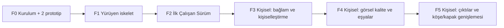

# Wardrobe Studio — Bağımsız Mimari Değerlendirme ve Gemini Çapraz Raporunun Denetimi (Claude)

> **İncelenen belgeler (üçü de eksiksiz okundu):**
> - Belge 1: `implementation_plan_gemini.md` (333 satır) → aşağıda **[G-§n]**
> - Belge 2: `gemini_review_of_claude.md` (243 satır) → aşağıda **[GR-§n]**
> - Belge 3: `bagimsiz_arastirma_ve_plan_claude.md` (ilk raporumla bayt düzeyinde aynı, hash ile doğrulandı) → aşağıda **[C-§n]**
>
> **Yöntem:**
> - **Aşama A:** Belge 1 ve 3, Belge 2 açılmadan karşılaştırıldı ve notlar çıkarıldı.
> - **Aşama B:** Belge 2 bu notlarla yan yana denetlendi.
> - Üç teknik iddia hedefli kaynak taramasıyla kontrol edildi: N8AO'nun saydam nesnelerle davranışı, react-spring'in `frameloop="demand"` ile birlikte çalışması, OneDrive'da klasör hariç tutma.
>
> **Karar etiketleri:** **Kabul et · Değiştir · Ertele · Doğrula · Reddet**
> Tarih: 28.10.2026

---

## 1. Yönetici Özeti

1. **Temel mimaride iki plan gerçekten yakınsıyor:**
   - JSON tasarım belgesinden saf bir çözümleyiciye, oradan render katmanına akış
   - Özyinelemeli bölme ağacı
   - Kol + Birleşim grafiği
   - R3F, Zustand ve Zod
   - Sunucu, fizik motoru ve CAD çekirdeği kullanılmaması

   Bu ortak omurga nihai plana **doğrudan alınabilir**. Ancak Gemini'nin raporundaki "tartışmaya kapalı / kesin kanıt" dili [GR-§1, §2] fazla güçlüdür. İki dil modelinin aynı sonuca varması güçlü bir işarettir, kanıt değildir. Riskli kısımlar (köşe geometrisi, görsel hat, düzenleme UX'i) yine prototiple doğrulanmalıdır.
2. **Gemini'nin çapraz raporu büyük ölçüde dürüst ve doğru.** Kendi planından altı kararı benim planım lehine değiştirmesi [GR-§6] isabetli. Benim planımda bulduğu sorunların çoğu da haklı:
   - 3D'siz ilk aşama
   - `AccumulativeShadows` ile animasyon çelişkisi
   - Fazla mod ve sürükleme
   - Köşe kapağı mekanizmasının belirsiz kalması
3. **Raporun en önemli eksiği kapsam yönetimi.** Rapor, iki planın en iyi fikirlerini *toplayarak* birleştiriyor ve neredeyse hepsini v1'e koyuyor:
   - 4 köşe tipi
   - 4 kapak mekanizması (menteşeli, katlanır, sürgülü, kalkar)
   - N8AO ve LED aydınlatma
   - Eşya görselleştirme
   - Envanter, ergonomi ve oda engelleri
   - A/B karşılaştırma ve marangoz çıktısı

   Bu "ilk çalışan sürüm" değil, tamamlanmış kişisel platform tanımıdır. **Üç katmanlı kapsam** (İlk Çalışan Sürüm → Kişisel Platform → Sonraki Sürümler) şart.
4. **Rapordaki dört sonuç düzeltilmeli:**
   - **Dar niş için sabit "160 mm alt sınır" önerisi** yine sabit bir sayıya dayanıyor. Doğrusu eşya ölçüsüne dayalı **sığma ve çıkarılabilirlik doğrulaması** (§7, Fikir 1). Gemini'nin kendi örneği bu ihtiyacı kanıtlıyor: 130 mm merdiven + 90 mm ütü masası = 220 mm niş [G-§4.4, §5.1]. Burada el payı sıfırdır ve menteşe çıkıntısı hesaba katılmamıştır.
   - **"Katlanır köşe kapağı zorunludur"** [GR-§5.4] fazla kesin. Türkiye'deki yaygın uygulama olan kör kasa + iki ayrı menteşeli kapak daha basit ve sağlam bir varsayılandır. Tam boy katlanır kapak donanım ve sarkma açısından **doğrulanmalıdır**.
   - **"Kademeli köşe"** ayrı bir köşe tipi değildir. İki kolun farklı derinlikte olması, **her köşe tipinin desteklemesi gereken bir özelliktir**.
   - **"60 FPS sağlar", "<16 ms", "≥55 FPS"** gibi değerler ölçüm yapılmadan kabul kriteri olarak yazılmış. Bu hatayı benim planım da içeriyordu. Bunlar hedef cihazda ölçülecek **hipotezler** olarak yeniden yazılmalı.
5. **Gemini'nin raporunda göremediği önemli bir sıralama sorunu:** Gemini'nin orijinal planında IndexedDB otomatik kaydı ve JSON dışa aktarımı **Faz 5'te** [G-§9]. Rapor da bunu açıkça düzeltmiyor. Ebeveynler haftalarca tasarım yapacağı için **veri kalıcılığı ve şema sürümü ilk aşamada** olmalı.
6. **Önerdiğim geliştirme sırası:** "Yürüyen iskelet" yaklaşımı. Çözümleyici ve testlerle birlikte, yalnızca çözülmüş modeli okuyan teşhis amaçlı bir 3D görüntüleyici ilk aşamada kurulur. Ondan önce iki kısa teknik prototip yapılır:
   - Köşe koordinatlarının doğrulanması
   - Görsel hattın hedef cihazda ölçülmesi

---

## 2. Orijinal İki Plan Arasındaki Gerçek Ortak Kararlar

Bu kararlar kısa tutuldu; hepsi için ön karar **Kabul et**.

| Konu | Claude | Gemini | Karar ve not |
|---|---|---|---|
| Gerçeğin tek kaynağı ve saf çözümleyici | [C-§3.1] | [G-§6.1] | **Kabul et**: 3D hesap yapmaz |
| Yığın: Vite, React, TS strict, R3F, drei, Zustand, Immer, Zod, Tailwind | [C-§2] | [G-§3] | **Kabul et**: sürüm uyumu kurulumda doğrulanacak (§10) |
| Kutu + `ExtrudeGeometry`; CAD çekirdeği yok | [C-§2.3, §4.1] | [G-§3.1, §4.1] | **Kabul et** |
| Özyinelemeli bölme ağacı | [C-§3.3] | [G-§5.1] | **Kabul et** |
| Kol/Duvar + Köşe Birleşimi grafiği; U şekli yalnızca veri modelinde | [C-§3.3] | [G-§6.2] | **Kabul et** |
| Dünya ölçeğinde UV + damar yönü | [C-§4.1] | [G-§3.3, §7] | **Kabul et** |
| Kinematik yay animasyonu; fizik motoru yok; 2D analitik süpürme alanı | [C-§4.2] | [G-§3.2, §4.3] | **Kabul et** |
| Sunucusuz yerel kalıcılık (IndexedDB + JSON) | [C-§2.3] | [G-§3.4] | **Kabul et** (zamanlaması için §9'a bakın) |
| Aynı sahnede ortografik ölçülü ön görünüş | [C-§1.3] | [G-§1.1] | **Kabul et** |
| Prosedürel, instanced ve düşük poligonlu eşya içerikleri | [C-§4.4] | [G-§4.4, §7] | **Kabul et** |
| v1'de uygulama içi LLM yok; JSON ile dış AI köprüsü; kural tabanlı danışman | [C-§7] | [G-§6.3] | **Kabul et** (köprü biçimi için §5, Madde 8'e bakın) |
| Yazılım kuralları ile uzman kontrolü ayrımı | [C-§8] | [G-§6.4] | **Kabul et** |

Gemini, renderer seçimini açıkça tartışmıyor. Ancak `@react-three/postprocessing` ve N8AO tercihi fiilen WebGL demek. Bu da benim "v1'de WebGL" kararımla [C-§2.2] uyumlu.

---

## 3. Bağımsız Karşılaştırmamın Temel Sonuçları (Aşama A)

### 3.1 Gemini'nin orijinal planında benimkinden güçlü olan noktalar

| # | Konu | Neden daha güçlü | Karar |
|---|---|---|---|
| G1 | **Gerçek ölçülü özel eşya kütüphanesi** (merdiven 480×130×1550, ütü masası 420×90×1500, düzenleyici kutular, valiz) [G-§4.4] | Eşyaları süs olarak değil **ölçek referansı** olarak kullanıyor. Benim kapasite formüllerimden daha somut ve dar niş doğrulamasının temeli olabilir | **Kabul et** (§7'de geliştirildi) |
| G2 | **Önce kapağı açan iç çekmece etkileşimi** [G-§4.3.1] | Küçük ama doğal bir UX detayı | **Kabul et** |
| G3 | **Asimetrik derinlik farkındalığı** (sol 580, sağ 450 mm) [G-§4.1, §5.2] | Benim planımda açıkça yoktu | **Değiştir**: ayrı köşe tipi değil, kol özelliği olmalı |
| G4 | **Katlanır köşe kapağı kinematiği** [G-§4.2] | Benim planım köşe ön cephesinin nasıl açılacağını tanımlamamıştı | **Doğrula + Ertele** (§5, Madde 2) |
| G5 | **Seçim + denetçi + adım kontrolleri, serbest 3D sürüklemenin yerine** [G-§2, §10.4] | Hata payı daha düşük ve daha hızlı uygulanır | **Kabul et** |
| G6 | **Somut ve sayısal kabul kriterleri** (800 − 2×18 = 764 mm) [G-§9] | Test edilebilirlik açısından örnek alınacak bir biçim | **Kabul et** |
| G7 | **Hızlı düzeltme eylemleri** [G-§6.3.1] | Benim "Neden?" önerimin uygulanabilir tamamlayıcısı | **Kabul et** |
| G8 | **AI köprüsünde tam JSON alternatifini A/B ekranına yapıştırma** [G-§6.3.2] | v1 için benim komut şeması önerimden daha basit; komut DSL'i gerektirmez | **Kabul et** (benim planımı düzeltir) |
| G9 | **Anne ve baba göz hizası kamerası** [G-§1.1] | Ben bunu v1.x'e bırakmıştım. Ucuz ve ergonomi özelliğiyle doğrudan bağlantılı | **Kabul et** (Kişisel Platform katmanı) |

### 3.2 Benim planımda Gemini'ninkinden güçlü olan noktalar (Aşama A tespiti)
Oda engelleri ve süpürme alanı, iki kişilik ergonomi, sahiplik, envanter, `fixed | flex` dağıtımı ve kilit, modül kaydı (`InsertRegistry`), tamsayı mm, şema sürümü, uzman etiketi ve nem riski, repo konumu riski. Gemini raporunda bunların neredeyse tamamını doğru biçimde tespit edip kabul etti [GR-§4]. Bu yüzden burada tekrar gerekçelendirilmiyor.

### 3.3 Gemini'nin orijinal planındaki sorunlar (Aşama A tespiti)

| # | Sorun | Kaynak | Karar |
|---|---|---|---|
| S1 | v1 kapsamı fiilen tamamlanmış kişisel platform; ilk çalışan sürüm tanımı yok | [G-§2] | **Değiştir** |
| S2 | Kalıcılık ve otomatik kayıt Faz 5'te; şema sürümü ve göç fonksiyonları hiç yok | [G-§9, §3.4] | **Değiştir**: Faz 1'e alınmalı |
| S3 | Ölçülmemiş performans garantileri: "<0,5 ms", "<16 ms", "60 FPS bozmadan" | [G-§3.1, §9] | **Değiştir**: ölçüm protokolüne çevrilmeli |
| S4 | Plan "6 aşama" diyor ama 5 faz listeliyor | [G-§9] | **Değiştir** (tutarsızlık) |
| S5 | Kapak pivotu modül kenarına bağlı (`x = ±moduleWidth/2`); kapak modülün alt parçası | [G-§4.2] | **Değiştir** (§5, Madde 7) |
| S6 | Sabit mekanik sayılar: normal menteşe 105°, köşe 165°, çekmece çıkışı `0,82 × derinlik`, iç çekmece çıtası "en az 25 mm" | [G-§4.2, §4.3] | **Değiştir**: menteşe ve kızak tipine bağlı parametreler olmalı. Örneğin 155° sıfır çıkıntılı menteşede çıta gerekmeyebilir, tam çekmeli kızakta çıkış oranı 1,0'dır |
| S7 | 220 mm niş örneğinde el payı ve menteşe çıkıntısı yok (130 + 90 = 220) | [G-§5.1, §9-Faz2] | **Değiştir** (§7, Fikir 1) |
| S8 | v1'de `three-bvh-csg` | [G-§3.1] | **Reddet** (v1 için). Gemini de kabul etti [GR-§6.1] |
| S9 | Oda bağlamı yalnızca süpürgelik ve kirişten ibaret; oda kapısı, yatak, pencere, radyatör yok | [G-§1.1] | **Değiştir**. Gemini de kabul etti |
| S10 | Ergonomi sabit `>1950 mm` eşiğine dayanıyor | [G-§6.4] | **Değiştir**: profile bağlı olmalı. Gemini de kabul etti |
| S11 | Kalkar kapak ve sürgülü kapak v1'de | [G-§2] | **Ertele**: kullanıcı sürgülü kapak tercihini henüz bildirmedi |

---

## 4. Gemini'nin Çapraz Değerlendirmesinde Doğru Bulduğum Kararlar

| # | Gemini'nin değerlendirmesi | Kaynak | Karar ve not |
|---|---|---|---|
| D1 | Tamamen 3D'siz ilk aşama riskli: test ile kod aynı koordinat varsayımını paylaşınca testler yeşil geçer ama sahne yanlış görünür | [GR-§5.1] | **Kabul et**. Güçlü ve doğru bir gözlem. Benim planımın en önemli zaafıydı |
| D2 | `AccumulativeShadows` animasyonlu kapaklarla çelişir | [GR-§5.2.1] | **Kabul et**. Hareket sırasında eski gölge kalır ya da gölge sürekli yeniden hesaplanır |
| D3 | Mod sayısı 6'dan 3 adıma inmeli; kapak görünürlüğü her modda hızlı anahtarla kontrol edilmeli | [GR-§5.5] | **Kabul et**. Ancak benim planımdaki "İç Düzen modunda kapaklar otomatik **açılır**" seçeneği çakışmaları görünür kılıyordu, gizlemiyordu; o kısım yanlış aktarılmış (§5) |
| D4 | Birincil etkileşim hücre seçimi + denetçi; sahnede sürükleme isteğe bağlı | [GR-§5.5, §7C.2] | **Kabul et** |
| D5 | Köşe tiplerinin belirsizliği: ön cephe mekanizması tanımlanmalı | [GR-§5.4] | **Kabul et** (ihtiyaç); **Değiştir** (önerilen çözüm, §5) |
| D6 | Esnek dağıtımda yuvarlama ve kalan milimetrenin son esnek hücreye verilmesi | [GR-§3.6] | **Kabul et**. Değerli bir ekleme; çözümleyicinin sözleşmesine yazılmalı |
| D7 | Hafif A/B: çift tuval yerine adlandırılmış sürümler ve fark tablosu | [GR-§7B.4] | **Kabul et** |
| D8 | Tam yürüme modu (WASD) yerine sabit göz hizası bakış noktaları | [GR-§7C.3] | **Kabul et** |
| D9 | CSG, karusel, pantograf, path tracing, WebGPU, AR, uygulama içi LLM ertelenmeli | [GR-§7C] | **Kabul et** |
| D10 | Eşikler `validationConfig` içinde yapılandırılabilir olmalı | [GR-§9.4] | **Kabul et** |
| D11 | Komut + anlık görüntü geçmişi, Zundo'ya tercih edilmeli | [GR-§3.5] | **Kabul et**. Not: özel kod gerektirir (yaklaşık 150–250 satır). Kaydırıcı sürüklemesinde işlem gruplama (transaction) test edilmeli |
| D12 | Kendi planındaki 6 kararın Claude lehine güncellenmesi | [GR-§6] | **Kabul et**. Dürüst bir öz eleştiri |
| D13 | Peer dependency uyumu kurulumda doğrulanmalı | [GR-§9.1] | **Kabul et** |

---

## 5. Gemini'nin Hatalı, Eksik veya Fazla Kesin Değerlendirmeleri

| # | Nokta | Kaynak | Sorun | Karar |
|---|---|---|---|---|
| 1 | "Ortak kararlar tartışmaya kapalı, doğruluğu güçlü biçimde kanıtlanmış" | [GR-§1, §2] | Yakınsama bir kanıt değildir; iki model benzer eğitim önyargılarını paylaşabilir. Mimari omurga makul, ama köşe çözümleyicisi ve görsel hat yine prototip ister | **Değiştir** (dil ve süreç) |
| 2 | "L köşede katlanır kapak **zorunludur**" | [GR-§5.4] | Alternatifler var: kör kasa / dolgu panelli iki ayrı menteşeli kapak (Türkiye'de yaygın uygulama), 165–170° menteşeli kapaklar, açık köşe. Yaklaşık 2,2 m boyunda katlanır kapak ağırlık, sarkma ve donanım bulunabilirliği açısından belirsiz. Gemini'nin `θ2 = −1,8·θ1` formülü de görsel bir yaklaşıklıktır [G-§4.2] | **Değiştir**: varsayılan kör köşe + iki kapak; katlanır kapak **Doğrula + Ertele** |
| 3 | 4 köşe tipinin v1'de olması; "Açık/Kademeli" tek tip | [GR-§7A.A5] | Kademeli (farklı derinlik) bir tip değil, **kol özelliği**dir; tüm köşe tiplerinde `depthA ≠ depthB` desteklenmeli. İlk çalışan sürüm için kör köşe + beşgen/diyagonal yeterli. Beşgen, kullanıcının açık talebi | **Değiştir** |
| 4 | Dar servis nişi için `160 mm` minimum, `200 mm` altı bilgi uyarısı | [GR-§5.3, §10.5] | Yine sabit eşik. Kullanıcı açıkça eşya ölçüsü, yönü ve çıkarılabilirliğe dayalı doğrulama istiyor. Ayrıca benim planımı yanlış aktarıyor: planımda 30–45 cm modül tablosunda tipik bir aralık olarak geçiyordu; 300 mm altını **engelleyen** bir kural yoktu [C-§5.2, §8.1]. Yine de o aralık ince merdiven nişi için yanlış bir yönlendirmeydi; bu eleştiriyi kabul ediyorum | **Değiştir**: eşya tabanlı sığma ve çıkarılabilirlik (§7, Fikir 1) |
| 5 | İç LED aydınlatma v1'de zorunlu; "iç bölmeler LED olmadan karanlık kalır" | [GR-§5.2.3, §7A.A6] | Karanlık iç sorunu öncelikle ortam aydınlatması (IBL) ve pozlama ile çözülür. LED, kullanıcı gerçek dolapta LED istiyorsa değerli bir **ürün** özelliğidir. Çok sayıda nokta/spot ışık her malzemenin shader maliyetini artırır; `RectAreaLight` gölge üretmez | **Değiştir**: Kişisel Platform katmanında, emissive şerit + kol başına en fazla 1 hafif ışık; maliyet P2 prototipinde ölçülür |
| 6 | `frameloop="demand"` ile yay animasyonları donar | [GR-§5.2.2] | Kısmen doğru. `@react-spring/three` R3F'in yeniden çizim tetikleyicisine bağlanır ve kare yenilemeyi kendisi ister (hedefli kaynak kontrolü). Sorun yalnızca `maath`/`useFrame` tabanlı elle sönümlemede yaşanır | **Değiştir**: kural "animasyon yalnızca `@react-spring/three` ile; `useFrame` kullanılırsa `invalidate()` zorunlu" olmalı |
| 7 | "N8AO + ContactShadows ile kapak animasyonları çalışırken 60 FPS akıcılıkta…" | [GR-§7A.A6], ayrıca "≥55 FPS" [GR-§9.3] | Ölçülmemiş bir garanti. `ContactShadows` varsayılan ayarda her karede yeniden render edilir; `frames={1}` ile statikleştirilirse açılan kapağın gölgesi güncellenmez. N8AO'nun yarım çözünürlük ve saydamlık algılama seçenekleri var, ama X-ray modunda davranışı test edilmeli | **Doğrula** (P2 prototipi) |
| 8 | AI köprüsünde iki plan aynı | [GR-§2] | Fark atlanmış. Gemini tam JSON alternatifini A/B ekranına aktarıyor [G-§6.3]; ben LLM'e komut şeması öneriyordum [C-§7.2]. v1 için Gemini'nin yolu daha basit ve daha iyi | **Değiştir**: v1 tam JSON + Zod + fark/A-B; LLM komut şeması v2 |
| 9 | Bağımsız `Front` katmanı "kesin olarak daha üstün" | [GR-§3.1] | Model esnekliği doğru. Ama menteşeli kapaklarda gerçek ritim genellikle gövdeyle aynıdır. Her kapağı elle tanımlamak kullanıcıya yük olur | **Değiştir**: veri modelinde bağımsız katman olsun, ama varsayılan kapak düzeni **bölmeden otomatik türetilsin** (1 veya 2 kapak; kapak genişliği sınırına göre). Kapsama/birleştirme ve sürgülü kapak (kol düzeyi) üzerine yazma (override) ile yapılsın |
| 10 | OneDrive'da `node_modules` hariç tutularak mevcut dizinde sorunsuz çalışılabilir | [GR-§5.6] | Kişisel OneDrive'da ada göre klasör hariç tutma yok; yalnızca kurumsal ilke (GPO) veya bağlantı noktası (junction) gibi geçici çözümler var. Türkçe karakterli yol riski de ayrıca duruyor | **Değiştir**: varsayılan öneri repoyu OneDrive dışına taşımak; karar kullanıcının |
| 11 | Satır içi aritmetik (`1200/3`) aşırı mühendislik | [GR-§7C.2] | Birkaç düzine satırlık, düşük riskli bir kolaylık. Önemli değil | **Ertele** (isteğe bağlı) |
| 12 | Kendi planındaki S2, S3, S4, S6 ve S7 sorunlarını belirtmemiş | [GR-§6] | Öz eleştiri iyi ama eksik: kalıcılığın geç gelmesi, performans garantileri, sabit mekanik sayılar ve faz sayısı tutarsızlığı | **Değiştir** |
| 13 | Askı derinliği eşiği bir yerde `<520 mm` [G-§6.4], başka yerde `<550 mm` [GR-§7B.6] | — | Tutarsız değer | **Değiştir**: tek yapılandırma değeri olmalı |
| 14 | Sentez yol haritasında görsel kalite, eşyalar, A/B ve çıktılar tek son fazda | [GR-§8, Aşama 6] | Son faz aşırı yüklü; görsel risk en sona kalıyor | **Değiştir** (§9) |

**Gemini planları doğru anlamış mı?** Genel olarak evet. Önerilerimi aktarmasında üç sapma var: Madde 4 (niş aralığının kural gibi okunması), D3 notu (otomatik açılan kapaklar) ve Madde 8 (AI köprüsü farkının görülmemesi). Hiçbiri kasıtlı bir çarpıtma gibi görünmüyor.

---

## 6. Kendi İlk Planımda Düzeltilmesi Gereken Konular

| # | İlk kararım | Düzeltme | Karar |
|---|---|---|---|
| K1 | A1 tamamen 3D'siz; "A1 bitmeden A2'ye geçilmez" [C-§11] | Yürüyen iskelet: çözümleyici + testler + teşhis amaçlı 3D görüntüleyici aynı aşamada. Kalite kapısı korunur ama "3D yok" koşulu kalkar | **Değiştir** |
| K2 | Sunum modunda `AccumulativeShadows` [C-§4.3] | Varsayılan hattan çıkarılır. Hareketsiz "fotoğraf çek" çıktısı için ileride yeniden değerlendirilebilir | **Değiştir** |
| K3 | İç LED aydınlatma v2+ [C-§4.3] | Kişisel Platform katmanına alınır (P2 ölçümüne bağlı) | **Değiştir** |
| K4 | Dar niş için "30–45 cm" referansı [C-§5.2] | Eşya tabanlı sığma ve çıkarılabilirlik doğrulaması | **Değiştir** |
| K5 | 6 mod + sürükle-bırak birincil etkileşim [C-§1.4, §1.5] | 3 adım + global kapak/X-ray anahtarları; denetçi birincil; ön görünüşte sürükleme sonraki katman | **Değiştir** |
| K6 | Tüm ölçülerin 32 mm adımlara yapışması [C-§1.3, §1.5] | 32 mm yalnızca ayarlı raf pimleri için. Sabit paneller 1 mm hassasiyetle, varsayılan adım 10 mm. 32 mm sistemi gömme ve özel üretimde her panel için bağlayıcı değildir | **Değiştir** |
| K7 | Kapakların tamamen bağımsız katman olarak elle tanımlanması [C-§3.3] | Otomatik türetilen varsayılan + üzerine yazma (§5, Madde 9) | **Değiştir** |
| K8 | v1 AI köprüsü komut listesi ile [C-§7.3] | Tam JSON içe aktarımı → varyant → fark tablosu. Komutlar dahili API olarak kalır | **Değiştir** |
| K9 | Başarı kriterlerinde "≥55 FPS", "≥45 FPS" [C-§11] | Hedef cihazda ölçülen taban değer ve kabul eşiği P2'den sonra belirlenir | **Değiştir** |
| K10 | Köşe tiplerinde ön cephe mekanizmasının tanımsız olması [C-§3.3, §5.1] | Her köşe tipi için varsayılan kapak stratejisi tanımlanır: kör → dolgu + iki kapak; diyagonal → tek açılı kapak (geniş açılı menteşe); L askı → kör köşe ile birleşik; katlanır → doğrulama sonrası | **Değiştir** |
| K11 | 8 aşama [C-§11] | 6 aşamaya birleştirilir (§9) | **Değiştir** |
| K12 | Envanter + ergonomi + sahiplik "v1" [C-§9.1] | İlk çalışan sürümde değil, Kişisel Platform katmanında. Veri modelinde yerleri ilk günden ayrılır | **Değiştir** |

---

## 7. Nihai Plana Alınması Gereken En Güçlü Fikirler

**Mimari omurga (ortak):** §2 tablosunun tamamı. Bunlara ek olarak: `fixed | flex` + kilit + kalan mm dağıtımı, `InsertRegistry`, tamsayı mm, şema sürümü + göç fonksiyonları, kalıcı semantik kimlikler, komut + anlık görüntü geçmişi. Hepsi **Kabul et**.

**Ürünü farklılaştıran fikirler:**

| # | Fikir | Kaynak | Karar |
|---|---|---|---|
| 1 | **Eşya tabanlı sığma ve çıkarılabilirlik doğrulaması** (yeni sentez, aşağıda) | G1 + benim envanter fikrim + kullanıcı talebi | **Kabul et** (çekirdek kuralı ilk çalışan sürümde, envanter Kişisel Platform'da) |
| 2 | Oda engelleri + zeminde süpürme alanı (yatak, oda kapısı, radyatör) | Claude | **Kabul et** |
| 3 | Anne ve baba ergonomi profili + göz hizası kamera ön ayarları + sahiplik | Claude + Gemini | **Kabul et** |
| 4 | Kapasite/envanter sayacı + gerçek ölçülü eşya gösterimi | Claude + Gemini | **Kabul et** |
| 5 | "Neden?" açıklaması + hızlı düzeltme + "uzman gerekir" etiketi | Claude + Gemini | **Kabul et** |
| 6 | Önce kapağı açan iç çekmece etkileşimi | Gemini | **Kabul et** |
| 7 | Adlandırılmış sürümler + fark tablosu (hafif A/B) | Sentez | **Kabul et** |
| 8 | Türk evine uygun yüklük/yorgan bölmesi, kademeli L askı ve kör köşede valiz şablonları | Claude | **Kabul et** |
| 9 | Hazır iç düzen şablonları + "bu hücreyi böl" hızlı eylemleri | Gemini | **Kabul et** |

### Fikir 1 — Eşya tabanlı sığma ve çıkarılabilirlik doğrulaması (dar nişler için)

Sabit minimum genişlik yerine, eşyanın **gerçek ölçüsü, saklama biçimi ve çıkarılma yolu** denetlenir. Saf TS, 2D/kutu hesabıyla çalışır; fizik motoru gerekmez.

1. **Eşya tanımı:**
   - Kullanıcının ölçtüğü `w × d × h` değerleri
   - İzin verilen yönler (ör. merdiven: ince kenarı önde veya yanda)
   - Saklama biçimi: zemine dayalı / kancaya asılı / kapak arkasına monte
   - Tutma payı (varsayılan 30–50 mm)
   - Kancalı eşya için kaldırma payı
2. **Statik sığma:** Yönlendirilmiş kutu + paylar, hücrenin net iç ölçüsünden küçük olmalı.
3. **Çıkarma yolu:**
   - Eşyanın ön kesiti, **etkin kapak açıklığından** geçmeli. Etkin açıklık şöyle hesaplanır: hücre net genişliği − menteşe tarafı çıkıntısı (menteşe tipi ve çıtaya göre) − çift kapakta karşı kapak kenarı.
   - Asılı eşyada `h + kaldırma payı ≤ hücre net yüksekliği` olmalı.
4. **Kapak arkasına monte eşya:** Eşya derinliği + iç içerik derinliği hücre derinliğini aşmamalı. Kapak yayı, eşya kalınlığı kadar büyür ve süpürme alanı kuralına girer.
5. **Oda tarafı:** Çıkarılan eşyanın önünde yeterli zemin alanı olmalı (oda engelleri katmanıyla birlikte).
6. **Çıktı biçimi:** Sayısal pay ile sunulur. Örnek: "Ütü masası sığıyor, ancak menteşe tarafında 8 mm el payı kalıyor; önerilen ≥30 mm. Hızlı düzeltme: nişi 30 mm genişlet / kapağı karşı yöne menteşele."

Bu yaklaşım Gemini'nin 220 mm örneğinde iki sorunu yakalardı: el payının sıfır olması ve menteşe çıkıntısı. Aynı model ileride ayakkabı, valiz ve kutu gibi tüm "ölçülü eşyalara" genellenebilir.

---

## 8. Kapsam Ayrımı

"Kaldırma" ile "erteleme" farklı şeylerdir:
- **Ertelenen** bir özelliğin veri modelindeki yeri ilk günden ayrılır (alan, tip, kayıt), ancak arayüzü ve davranışı yazılmaz.
- **Reddedilen** bir özellik için plan ve model hiçbir hazırlık yapmaz.

| Özellik | İlk Çalışan Sürüm (ÇS) | Kişisel Platform (KP) | Sonraki Sürümler | Karar |
|---|---|---|---|---|
| Düz + L gövde, `fixed/flex`, bölme ağacı | ✅ | | | Kabul et |
| U şekli | Yalnızca veri modeli | | Arayüz | Ertele |
| Köşe: kör (dolgu + iki kapak) | ✅ | | | Kabul et |
| Köşe: beşgen/diyagonal | ✅ | | | Kabul et (kullanıcı talebi + özel geometri kanıtı) |
| Köşe: L askı / kademeli askı | | ✅ (kör köşenin iç şablonu olarak) | | Kabul et |
| Köşe: katlanır kapaklı L-poligon | | Prototip sonucuna göre | ✅ | Doğrula + Ertele |
| Asimetrik kol derinliği | ✅ (modelde ve çözümleyicide) | | | Kabul et |
| Menteşeli kapak + dış çekmece + açık bölme, yay animasyonu | ✅ | | | Kabul et |
| Sürgülü kapak | | Kullanıcı isterse | ✅ | Ertele (kullanıcı kararı) |
| Kalkar kapak | | | ✅ | Ertele |
| Temel PBR + damar yönü + tek yönlü gölge + IBL | ✅ | | | Kabul et |
| N8AO / ContactShadows / sunum modu | | ✅ (P2 sonucuna göre ayar) | | Doğrula |
| İç LED (emissive + sınırlı ışık) | | ✅ | | Doğrula |
| Path tracing, WebGPU | | | ✅ | Ertele |
| Ortografik ölçülü ön görünüş | ✅ | | | Kabul et |
| Temel kurallar: çakışma, kapak genişliği, iç çekmece/menteşe, köşe kulp çarpışması, eşya sığma/çıkarılabilirlik | ✅ | | | Kabul et |
| Oda engelleri + süpürme alanı | | ✅ | | Kabul et |
| Ergonomi profilleri + göz hizası kamera + sahiplik | | ✅ | | Kabul et |
| Envanter sayacı + ölçülü eşya görselleştirme (instanced) | | ✅ | | Kabul et |
| glTF kıyafet paketleri, kumaş fiziği | | | ✅ / ❌ | Ertele / Reddet (kumaş fiziği) |
| Geri al/yinele, IndexedDB otomatik kayıt, JSON dışa/içe aktarım, şema sürümü | ✅ | | | Kabul et |
| Adlandırılmış sürümler + fark tablosu | | ✅ | | Kabul et |
| Çift tuvalle yan yana 3D A/B | | | ✅ | Ertele |
| Yazdırılabilir ölçülü çizim + CSV parça listesi | | ✅ | | Kabul et |
| Kesim optimizasyonu, CNC (`.dxf/.mpr`) | | | ✅ | Ertele |
| AI köprüsü (JSON kopyala/yapıştır → varyant) | | ✅ | | Kabul et |
| Uygulama içi LLM asistanı | | | ✅ | Ertele |
| Pantograf, karusel | | | ✅ | Ertele |
| CSG, fizik motoru, CAD çekirdeği | | | | Reddet (v1 için) |
| Bulut, çoklu kullanıcı, fiyatlandırma, ticari altyapı | | | ✅ | Ertele |

**ÇS'nin tanımı:** Ebeveynler kör veya beşgen köşeli bir L gardırobu kurabilir. Bölmeleri ve iç düzeni değiştirebilir, kapak ve çekmeceleri açabilir, ölçülü ön görünüşü okuyabilir, temel çakışma ve sığma uyarılarını görebilir. Yaptıkları işi kaybetmezler.

---

## 9. Geliştirme Aşamaları İçin Önerilen Düzeltmeler

Gemini'nin sentez yol haritası [GR-§8] doğru yönde. Benim önerdiğim düzeltmeler şunlar: kalıcılığı öne çekmek, görsel riski prototiple erkene almak, son fazın yükünü dağıtmak ve iki ara teslim tanımlamak.

| Faz | Kapsam | Doğrulanabilir başarı kriterleri |
|---|---|---|
| **F0** | Kurulum; peer dependency kontrolü; repo konumu kararı. **P1:** asimetrik derinlikli L-kör ve L-diyagonal köşe koordinat prototipi. **P2:** hedef dizüstünde görsel hat ölçümü (IBL + yönlü gölge ± N8AO ± ContactShadows ± LED, kapak animasyonu ve X-ray açıkken) | `dev/test/build` hatasız. P1'de iki köşe için paneller görsel olarak boşluksuz ve çakışmasız. P2 sonunda bir ölçüm tablosu ve varsayılan görsel ayarlar kararı yazılı (ADR) |
| **F1** | Zod şeması (sürüm + göç fonksiyonları), tamsayı mm, `fixed/flex` + kalan mm, Kol + Birleşim (kör köşe), bölme ağacı, `InsertRegistry` iskeleti, panel listesi, komut + geçmiş. **Teşhis 3D:** çözülmüş modeli tel kafes veya düz renkle çizen görüntüleyici. **Kalıcılık:** IndexedDB otomatik kayıt + JSON dışa/içe aktarım | Düz, L-kör ve U fikstürleri deterministik panel listesi üretir. Kilitli ölçü korunur; toplam genişlik değişince yalnızca esnek bölmeler değişir. Dışa aktarılıp içe aktarılan belge birebir aynı. Eski şema sürümü göç fonksiyonuyla açılır. Teşhis görünümünde fikstürler beklenen konumda |
| **F2 → ÇS** | Denetçi + yapı ağacı + hızlı böl/ata + şablonlar; temel modüller (raf, askı, çekmece, dar niş, üst bölüm/yüklük, ayakkabılık); beşgen/diyagonal köşe; menteşeli kapak + dış çekmece (bölmeden türetilen varsayılan kapak düzeni), yay animasyonu, X-ray; temel PBR + damar yönü; ortografik ölçülü ön görünüş; temel kurallar + eşya sığma ve çıkarılabilirlik | Kullanıcı boş projeden L tasarımını gözlemli bir oturumda engelsiz kurar. 50 adım geri al/yinele doğru. Her temel kuralın pozitif ve negatif testi var. 220 mm niş örneğinde sığma kuralı el payı uyarısı verir. Kapaklar menteşe tipine bağlı açıyla doğru pivotta açılır |
| **F3** | Oda engelleri + süpürme alanı; ergonomi profilleri + göz hizası kameraları; sahiplik; envanter sayacı; hızlı düzeltmeler; adlandırılmış sürümler + fark tablosu; AI JSON köprüsü | Profil boyu değişince erişim bölgesi güncellenir. Yatak engeli fikstüründe kapak yayı uyarısı tetiklenir. Envanter sayısı elle hesaplanan örnekle tutarlı. Dışarıdan yapıştırılan geçersiz JSON anlamlı bir hata verir |
| **F4** | Sunum kalitesi (P2 kararıyla N8AO/ContactShadows), cam/ayna/metal, iç LED, instanced ölçülü eşyalar | Performans P2'de ölçülen taban değerin altına belirlenen eşikten fazla düşmez. Eşyalar kapatılınca performans eski seviyeye döner |
| **F5** | Yazdırılabilir ölçülü çizim + CSV parça listesi + uzman kontrol listesi; prototip olumluysa katlanır L köşe; kullanıcı isterse sürgülü kapak | Çıktıdaki ölçüler çözümleyiciyle birebir (otomatik test). Bir usta veya teknik bilgisi olan biri çizimi okuyabilir |

---

## 10. Doğrulanması Gereken Teknik Varsayımlar

| # | Varsayım | Sınıf | Nasıl doğrulanacak |
|---|---|---|---|
| V1 | React 19 + R3F + drei + `@react-three/postprocessing` sürümlerinin uyumu | Makul varsayım | F0 kurulumu (context7 / paket peer dependency kontrolü) |
| V2 | Asimetrik derinlikte köşe poligonlarının boşluksuz kapanması | Hipotez | P1 + birim testleri |
| V3 | N8AO + gölge + kapak animasyonu + X-ray'in hedef cihazda akıcı çalışması | Hipotez | P2 ölçümü (FPS yerine kare süresi p95). N8AO'nun saydamlığı otomatik algıladığı kaynakta belirtiliyor, ama X-ray görünümü gözle kontrol edilmeli |
| V4 | `ContactShadows` statik/dinamik modu ile açılan kapak gölgesi arasındaki denge | Hipotez | P2 |
| V5 | `@react-spring/three`'nin `frameloop="demand"` modunda yeniden çizimi otomatik tetiklemesi | Kaynakla desteklenen bilgi (doğrulanmalı) | P2'de küçük test |
| V6 | L gardırop fikstüründe çözümleme süresinin kaydırıcı etkileşiminde hissedilmemesi | Hipotez | F1'de mikro ölçüm. Gerekirse kaydırma sırasında yalnızca etkilenen kol çözülür |
| V7 | Kaydırıcı sürüklemesinin geçmişte tek adım olarak kaydedilmesi (işlem gruplama) | Tasarım varsayımı | F1 testi |
| V8 | Ergonomi ve ölçü eşikleri (askı yükseklikleri, 520/550 mm askı derinliği, ~800–900 mm raf sehim açıklığı, 600 mm kapak genişliği) | Kaynaklarda tipik değer; bölgeye ve üreticiye göre değişir | `validationConfig`; ustanın veya üreticinin değerleriyle güncellenir |
| V9 | Menteşe tipine göre çıkıntı ve iç çekmece çıtası ihtiyacı (110° / 155° sıfır çıkıntı / 170°) | Üretici kaynaklarına dayalı makul bilgi | Seçilen marka kataloğu (Blum, Hettich, Samet) + usta |
| V10 | Tam boy katlanır köşe kapağının donanım ve sarkma açısından uygulanabilirliği | Belirsiz | Usta görüşü + kinematik prototip (F5 öncesi) |
| V11 | WebGPU'nun üretime hazır olduğu iddiası | İkincil kaynak | v1 kararını etkilemiyor; v2'de yeniden bakılır |

**Uzman kontrolü gerektirenler:** menteşe ve kızak modeli seçimi, raf yük ve sehim hesabı, duvara sabitleme, duvar gönye ve terazi toleransları ile yerinde tıraşlama (scribing), dış duvarda nem ve havalandırma, katlanır ve sürgülü kapak donanımı, üretim toleransları.

---

## 11. Ana Koordinatör Gemini'ye İletilecek Önceliklendirilmiş Kararlar

### Öncelik 0 — Nihai plan yazılmadan önce düzeltilmeli
1. **Üç katmanlı kapsam** (ÇS → KP → Sonraki) §8'deki tabloyla benimsensin. v1 tek parça bir liste olmaktan çıksın. **Değiştir**
2. **Kalıcılık ve şema sürümü F1'e** taşınsın (IndexedDB otomatik kayıt, JSON dışa/içe aktarım, göç fonksiyonları). **Değiştir**
3. **Performans garantileri kaldırılsın.** "60 FPS", "<16 ms", "≥55 FPS" ifadeleri, P2'de hedef cihazda ölçülen taban değer ve kabul eşiğiyle değiştirilsin. **Değiştir**
4. **Dar niş doğrulaması** sabit "160 mm" yerine eşya tabanlı sığma ve çıkarılabilirlik kuralı olsun (§7, Fikir 1). **Değiştir**
5. **Köşe stratejisi:**
   - ÇS'de kör (dolgu + iki kapak) ve beşgen/diyagonal köşe
   - Asimetrik derinlik tüm köşe tiplerinde bir özellik olarak desteklensin
   - Katlanır L köşe **Doğrula + Ertele**
   - "Katlanır kapak zorunludur" ifadesi kaldırılsın

   **Değiştir**
6. **Yürüyen iskelet sırası** (F0 prototipleri → F1 çözümleyici + teşhis 3D + kalıcılık) benimsensin. **Kabul et**

### Öncelik 1 — Nihai planda düzeltilmeli
7. Kapak katmanı: veri modelinde bağımsız olsun, varsayılan düzen bölmeden otomatik türetilsin, sürgülü kapak kol düzeyinde tanımlansın. **Değiştir**
8. AI köprüsü: v1'de tam JSON → Zod → varyant + fark tablosu (Gemini'nin orijinal yaklaşımı). LLM komut şeması v2. **Değiştir**
9. Görsel hattın ayarları P2 sonucuna göre belirlensin. LED Kişisel Platform katmanında; `AccumulativeShadows` ve CSG v1'de yok. **Doğrula**
10. Mekanik sabitler (105°/165°, 0,82 çıkış oranı, 25 mm çıta, 520/550 mm askı derinliği) menteşe ve kızak tipine bağlı parametreler olarak `validationConfig` içine taşınsın. **Değiştir**
11. Animasyon kuralı: yalnızca `@react-spring/three`; `useFrame` tabanlı hareket varsa `invalidate()` zorunlu. **Kabul et**
12. Repo konumu: OneDrive dışı önerilsin (kişisel OneDrive'da klasör hariç tutma yok). Karar kullanıcının. **Değiştir**

### Öncelik 2 — Küçük düzeltmeler
13. Belgelerde "tartışmaya kapalı / kanıtlanmış" dili "güçlü ortak kanaat, prototiple doğrulanacak" olarak yumuşatılsın.
14. Faz sayısı tutarsızlığı (6 deniyor, 5 listeleniyor) düzeltilsin.
15. 3 adımlı mod akışı + global kapak/X-ray anahtarları + denetçi birincil etkileşim olarak **Kabul et**. Ön görünüşte sürükleme ve satır içi aritmetik **Ertele**.

### Kullanıcının karar vermesi gereken açık sorular
- Repo konumu (OneDrive içi veya dışı)
- Sürgülü kapak gerçekten bir seçenek mi?
- Marangoz çıktısı Kişisel Platform katmanında mı kalsın, ÇS'ye mi alınsın?
- P2 için hedef cihaz (kullanılacak dizüstünün GPU'su)
