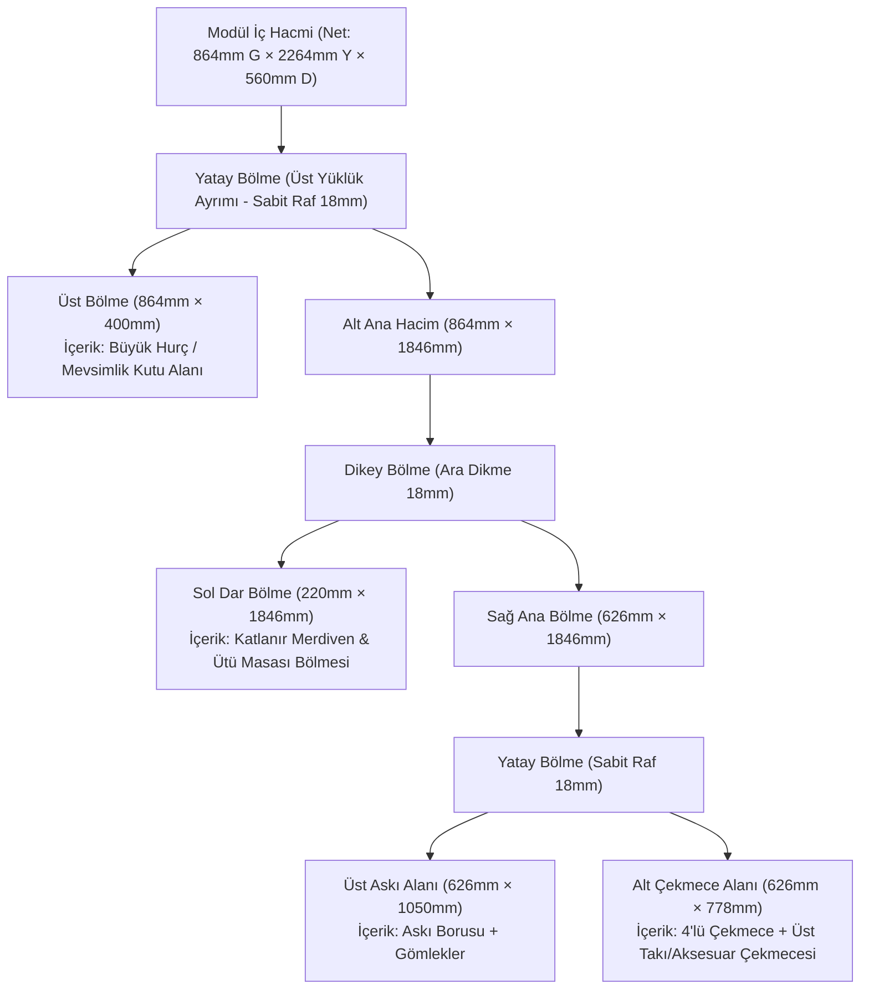
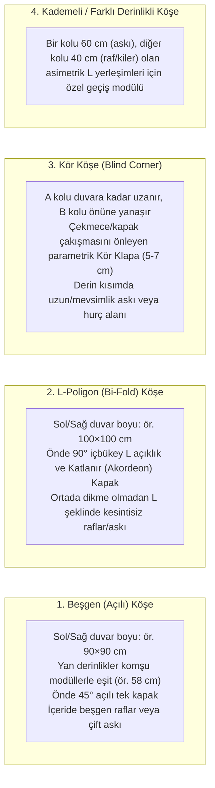
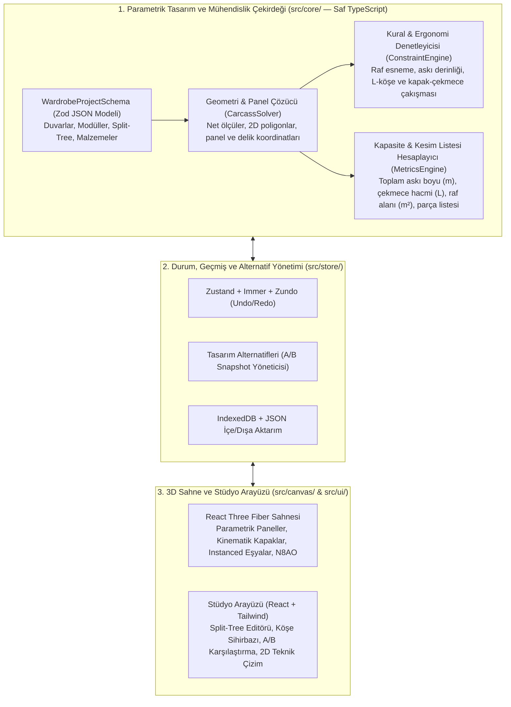

# L-Form Studio — 3D Gardırop Tasarım Platformu: Kapsamlı Araştırma, Mimari ve Proje Planı

## Yönetici Özeti (Executive Summary)

**L-Form Studio**, ilk aşamada anne ve babanın birlikte kullanacağı **L şeklinde gömme gardırobu** gerçek üretim ölçülerine, ergonomik kurallara ve estetik beklentilere tam uyumlu biçimde tasarlamak; gelecekte ise farklı oda ve gardırop tiplerini (düz, U-tipi, yürüyüşlü/walk-in, bağımsız modüler) destekleyebilecek esneklikte bir **3D Parametrik Dolap ve Depolama Tasarım Stüdyosu** oluşturmak üzere kurgulanmıştır.

Piyasadaki basit 3D dolap uygulamalarının en büyük kusuru, sabit 3D kutuları (`GLTF` modelleri) ölçekleyerek (scale) yan yana dizmeleridir; bu yaklaşım malzeme kalınlıklarını (18 mm panel kalınlığı) bozar, özel köşe geometrilerini (beşgen/L-köşe) desteklemez ve bir modülün içine hem dar dikey merdiven/ütü masası bölmesi hem de çekmece-askı kombinasyonu yerleştirmeye izin vermez.

**Temel Mimari Yaklaşımımız:**
1. **Saf Parametrik Geometri Çekirdeği (Pure TypeScript CAD-Lite Core):** Her bir mobilya paneli (dikme, alt/üst tabla, 8 mm arkalık, baza, taç, kör klapa, raf, bölme, kapak) sabit 3D varlıkların sündürülmesiyle değil, gerçek milimetrik parametrelerden (`mm`) ve 2D poligon profillerinin (`THREE.Shape` $\rightarrow$ `ExtrudeGeometry` / `BufferGeometry`) yükseltilmesiyle üretilir.
2. **Özyinelemeli İç Hacim Ağacı (Recursive Spatial Split-Tree):** Her modülün iç hacmi yatayda (raf/çekmece katmanları) ve dikeyde (ara dikmeler) istenildiği kadar alt hacme bölünebilir. Böylece tek bir modül içinde **22 cm genişliğinde tam boy katlanır merdiven/ütü masası bölmesi** ile **kalan genişlikte çekmece + askılık** kusursuzca kurgulanabilir.
3. **Dört Farklı L-Köşe Mühendisliği:** Standart dikdörtgen kutularla çözülemeyen L birleşimi için **Beşgen (Açılı) Köşe**, **L-Poligon (Katlanır Kapaklı / Bi-Fold) Köşe**, **Kör Köşe (Kör Klapa + Çarpışma Korumalı)** ve **Kademeli/Çok Derinlikli Köşe** modülleri birinci sınıf parametrik yapıtaşı olarak desteklenir.
4. **Kinematik Etkileşim ve Çakışma Denetimi:** Kapaklar (menteşeli, katlanır akordeon, sürgülü, kalkar) ve çekmeceler gerçek menteşe/ray eksenlerinde açılır; iç çekmecenin kapalı kapağa çarpması veya L köşedeki çekmecenin dik modül kulbuna takılması matematiksel olarak denetlenir.
5. **Yerel-Öncelikli (Local-First) ve Yapay Zekâya Hazır Veri Modeli:** Gereksiz sunucu/veritabanı karmaşıklığı olmadan tarayıcıda (`IndexedDB` + `.lform.json` dışa/içe aktarım) çalışır. Tüm gardırop deterministik bir JSON şemasıyla (`WardrobeProjectSchema`) temsil edildiği için hem **A/B tasarım alternatiflerini karşılaştırma** hem de **gelecekteki yapay zekâ tasarım asistanı** doğrudan bu şema üzerinden çalışır.

---

## 1. İlk Sürüm (v1) İçin Hedeflenen Kullanıcı Deneyimi (UX)

Kullanıcı bir CAD mühendisi olmak zorunda kalmadan, bir iç mimar hassasiyetinde tasarım yapabilmelidir. Bu dengeyi kurmak için **"Doğrudan 3D Etkileşim + Akıllı Şablonlar + Hassas Denetçi (Inspector)"** üçlüsü uygulanacaktır:

### 1.1 Çalışma Alanı (Studio Layout)
- **Sol Panel (Modül, Köşe ve İç Düzen Kütüphanesi):**
  - Duvar/L-Kurulum sekmesi (A ve B duvar uzunlukları, tavan yüksekliği, süpürgelik/kiriş payları, baza ve üst taç yüksekliği).
  - Hızlı modül ve özel bölme şablonları (Çift Askı, Uzun Elbise + Raf, Çekmece Kulesi, Merdiven/Ütü Masası + Çok Amaçlı Kiler, Beşgen Köşe, L-Katlanır Köşe vb.).
- **Merkez Sahne (3D Etkileşimli Görünüm + Görünüm Modları):**
  - **Serbest 3D Stüdyo Kamerası (Orbit):** Yumuşak sönümlemeli (damped) döndürme, yakınlaştırma ve seçili modüle odaklanma (`Focus on Module`).
  - **Göz Hizası / Kullanıcı Bakışı (First-Person / Ergonomi Kamerası):** Anne veya babanın boy yüksekliğinden (ör. 162 cm ve 178 cm göz hizası) gardırobun üst raflarına erişimi ve derinliği gerçekçi perspektiften görme.
  - **2D Teknik Cephe / Kesit Görünümü (Orthographic Elevation & Plan):** Tek tıkla perspektifi kapatıp milimetrik ölçü çizgileriyle (`Dimension Lines`) 2D teknik çizim görünümüne geçme.
- **Sağ Panel (Bağlamsal Denetçi — Contextual Inspector):**
  - Tıklanan öğeye göre (Tüm Gardırop $\rightarrow$ Seçili Modül $\rightarrow$ Seçili İç Bölme / Alt Hacim $\rightarrow$ Kapak/Çekmece) milimetrik ölçü, bölme ekleme/kaldırma, malzeme/kulp ve iç eşya ayarları.
- **Alt / Üst Araç Çubuğu (Hızlı Durum Anahtarları):**
  - `Kapakları Aç/Kapat` (Tümü veya seçili), `X-Ray / Kapakları Gizle`, `İç Eşyaları Göster (Doluluk Simülasyonu)`, `Ölçüleri Göster`, `Ergonomi & Çakışma Uyarıları`, `Tasarım Alternatifleri (A/B Karşılaştır)`.

### 1.2 Temel Etkileşim Akışı
1. **L-Gövde ve Köşe Seçimi:** Kullanıcı A ve B kollarının ölçülerini girer, köşe modülü tipini (ör. Beşgen Köşe, L-Katlanır Köşe veya Kör Köşe) seçer; kalan duvar boşlukları otomatik veya kullanıcının belirlediği modül genişlikleriyle (ör. 45 / 60 / 80 / 90 / 100 cm veya özel mm) doldurulur.
2. **İç Hacim Özelleştirme (Tıkla $\rightarrow$ Böl veya Doldur):** Kullanıcı bir modülün içindeki herhangi bir boşluğa tıkladığında:
   - **"Dikey Böl (Ara Dikme Ekle)"** veya **"Yatay Böl (Sabit Raf Ekle)"** diyerek alanı ikiye/çoğa ayırabilir (ör. 90 cm'lik modülün sol 22 cm'sini dikey bölüp ince-uzun merdiven bölmesi yapmak).
   - Oluşan her alt boşluğa **Raf Grubu**, **Askı Borusu (Üst/Alt/Pantolonluk)**, **Çekmece Grubu (Dış veya İç Çekmece)**, **Ayakkabılık**, **Takı/Aksesuar Çekmecesi** veya **Çok Amaçlı Kutu/Kiler Bölmesi** atayabilir.
3. **Etkileşimli Test:** Kapaklara ve çekmecelere doğrudan 3D sahnede tıklayarak açıp kapatır; iç eşyaları (askıdaki kıyafetler, katlı kazaklar, kutular, katlanır merdiven, ütü masası) açarak gerçek sığma durumunu inceler.
4. **Alternatif Kaydetme ve Karşılaştırma:** Mevcut tasarımı *"Alternatif 1: Beşgen Köşeli"* olarak kaydeder, tek tıkla kopyasını oluşturup *"Alternatif 2: L-Dolap + Kör Köşe"* üzerinde değişiklik yapar ve iki tasarımı hem görsel hem de kapasite metrikleriyle (toplam askı metresi, çekmece hacmi, raf alanı, köşe erişilebilirliği) yan yana karşılaştırır.

---

## 2. Kapsam Belirleme: Temel Özellikler (v1) ve Sonraya Bırakılacaklar (v2+)

Gereksiz mühendislik yükünden (overengineering) kaçınmak ve anne-babanın gerçek gardırobunu en yüksek kalitede tasarlamaya odaklanmak için özellikler net biçimde ayrılmıştır:

| Kategori | İlk Sürümde (v1) Olacak Kritik Özellikler | Sonraki Aşamalara (v2+) Bırakılacak Özellikler |
| :--- | :--- | :--- |
| **Geometri & Form** | L-şeklinde ve Düz (I-tipi) gömme gardırop; baza, üst taç ve yan duvar kör klapaları (filler); 18 mm / 25 mm gövde ve 8 mm arkalık parametrik üretimi. | Çatı katı eğimli tavan (sloped ceiling) kesimleri, U-tipi ve ada (island) dolap arayüzleri (veri modeli v1'de hazır olacak, UI v2'de açılacak). |
| **Köşe Çözümleri** | 4 ana köşe tipi: **Beşgen (Açılı) Köşe**, **L-Poligon (Bi-Fold) Köşe**, **Kör Köşe (Sağ/Sol öncelikli + kör klapa)**, **Kademeli Köşe**. | Döner mekanizmalı (karusel / fasulye) metal aksesuar simülasyonları. |
| **İç Düzen & Özel Bölmeler** | Özyinelemeli Dikey/Yatay Bölme Ağacı (Split-Tree); ince-uzun dikey bölme (merdiven/ütü masası/elektrik süpürgesi); hareketli/sabit raflar; iç/dış çekmeceler; kısa/uzun askı, pantolonluk, ayakkabılık, takı/aksesuar çekmecesi, kiler/kutu bölmeleri. | Asansörlü askı mekanizması (pantograf) kinematik animasyonu (v1'de statik/basit gösterim, v2'de tam kol animasyonu). |
| **3D Etkileşim & Animasyon** | Tıklamayla açılan/kapanan menteşeli, katlanır (bi-fold), sürgülü ve kalkar kapaklar; tıklamayla kayan çekmeceler; kapak-çekmece ve L-köşe çakışma kontrolü. | Sürükle-bırak ile 3D sahnede serbest raf/çekmece kaydırma (v1'de 3D seçim + hassas kaydırıcı/ok tuşları ile milimetrik taşıma çok daha hatasızdır). |
| **Görsel Kalite & Eşyalar** | PBR malzemeler (ahşap dokusu suyolu yönü destekli, lake, cam, ayna, metal profil), N8AO iç gölgelendirme, dolap içi LED şerit aydınlatma, parametrik iç eşya/doluluk önizlemesi (askıda giysiler, katlı çamaşırlar, kutular, ayakkabılar, merdiven, ütü masası). | Fotogerçekçi bulut tabanlı Ray-Tracing render alma; kumaş fiziği (cloth simulation) ile sallanan elbiseler. |
| **Ölçü, Kayıt & Karşılaştırma** | Gerçek zamanlı iç/dış net ölçü gösterimi, raf esneme ve ergonomi uyarıları, `IndexedDB` otomatik kayıt, `.lform.json` yedekleme, **A/B Tasarım Alternatifi Karşılaştırma**, 2D Teknik Cephe Özeti ve Kesim/Parça Listesi (Cutlist) çıktısı. | Çok kullanıcılı bulut hesabı, gerçek zamanlı ortak çalışma, CNC makinesi (`.dxf` / `.mpr`) delik-delme üretimi, fiyat/maliyet entegrasyonu. |
| **Yapay Zekâ (AI)** | AI-uyumlu deterministik JSON Şeması + Komut Protokolü (Claude/Gemini ile JSON üzerinden tasarım alışverişi) + **Yerleşik Kural Tabanlı Akıllı Ergonomi ve Yerleşim Danışmanı**. | Uygulama içi ücretli LLM API bağlantısı ve sunucu tarafı sohbet botu (v2'de isteğe bağlı BYOK / yerel anahtar ile eklenebilir). |

---

## 3. Teknoloji ve Mimari Araştırması (Seçimler ve Gerekçeler)

Seçilen her teknoloji; **parametrik modelleme kabiliyeti, görsel kalite, geliştirme hızı, bakım kolaylığı ve sıfır gereksiz altyapı** kriterlerine göre alternatifleriyle karşılaştırılmıştır:

### 3.1 3D Motoru ve Sahne Yönetimi
- **Seçilen:** **Three.js + React Three Fiber (R3F) + `@react-three/drei`**
- **İncelenen Alternatifler:**
  1. *Saf (Imperative) Three.js:* Gardırop gibi hiyerarşik bir ağaç yapısında (`Gardırop -> Kol -> Modül -> Alt Hacim -> Panel/Çekmece/Eşya`) bir modülün genişliği değiştiğinde yüzlerce alt parçanın eklenmesi, silinmesi ve güncellenmesini manuel `scene.add/remove` ile yönetmek ciddi bellek sızıntısı (memory leak) ve durum senkronizasyonu hatası üretir. R3F, parametrik veri ağacını doğrudan deklaratif bileşen ağacına dönüştürür.
  2. *Babylon.js:* Güçlü bir motor olmasına rağmen React UI ekosistemiyle entegrasyonu R3F kadar doğal değildir ve iç mimari görselleştirme/post-processing hazır bileşen ekosistemi (`drei`, `postprocessing`, `N8AO`) R3F tarafında çok daha zengindir.
  3. *WASM CAD Çekirdekleri (`OpenCascade.js` / `replicad` / `Manifold-3D`):*
     - **Kritik Mühendislik Kararı:** Tam bir B-Rep CAD çekirdeği (`OpenCascade.js`) tarayıcıya ~15-25 MB WASM yükü getirir ve kullanıcı bir genişlik kaydırıcısını (slider) sürüklerken saniyede 60 kez tüm gardırobun katı modelini yeniden hesaplamakta gecikme (lag) yaşatır.
     - Oysa mobilya panellerinin %95'i **dikdörtgen prizma** veya **2D çokgenin doğrusal yükseltilmesi (Linear Extrusion of 2D Polygon — ör. beşgen köşe rafı, L-köşe tablası)** şeklindedir. Bunlar `THREE.BufferGeometry` ve `THREE.ExtrudeGeometry` ile **< 0.5 milisaniyede (60 FPS akıcılıkta)** üretilir.
     - Nadir gereken boolean kesimler (ör. gömme kulp oyuğu veya özel kiriş çentiği) için yalnızca ilgili parçada hafif **`three-bvh-csg` (`@react-three/csg`)** kullanılacaktır.

### 3.2 Animasyon ve Kinematik
- **Seçilen:** **`@react-spring/three` + `maath` (Damping)**
- **Gerekçe:** Kapak ve çekmece açılışlarında doğrusal (linear) animasyonlar yapay durur. Yay fiziği (spring kinematics) ve sönümleme (damping), kullanıcı kapağı açılırken yarıda tekrar tıkladığında hızı sıfırlamadan doğal bir ivmeyle geri kapatmayı sağlar.

### 3.3 Görsel Gerçekçilik ve Aydınlatma
- **Seçilen:** **`@react-three/postprocessing` (`N8AO`) + `ContactShadows` + Dünya-Uzayı (World-Space) Prosedürel UV Haritalama**
- **Gerekçe:**
  - Gardırop içindeki rafların ve köşelerin derinlik algısı için en kritik unsur **Ambient Occlusion (Ortam Kapatma / Köşe Gölgeleri)**'dir. `N8AO`, WebGL'de düşük GPU maliyetiyle iç bükey köşelerde çok kaliteli yumuşak gölgeler üretir.
  - **Dünya-Uzayı UV (Triplanar / Box UV):** Bir panel 40 cm'den 90 cm'ye büyüdüğünde ahşap dokusunun sündürülmemesi (stretch olmaması) için doku koordinatları `0..1` aralığına değil, gerçek milimetre ölçüsüne ve **suyolu yönüne (`grainDirection: 'vertical' | 'horizontal'`)** göre hesaplanacaktır.

### 3.4 Durum Yönetimi (State Management), Geri Al/Yinele ve Veri Saklama
- **Seçilen:** **`Zustand` + `Immer` + `Zundo` (Undo/Redo) + `Zod` (Şema Doğrulama) + `Dexie / idb-keyval` (IndexedDB)**
- **Gerekçe:**
  - Özyinelemeli iç hacim ağacında (`SplitNode`) derin güncellemeleri `Immer` ile temiz bir şekilde yapmak, `Zundo` ile tek satırda **Geri Al / Yinele (Ctrl+Z / Ctrl+Y)** geçmişi tutmak ve `IndexedDB` ile tarayıcı kapansa bile tüm tasarım alternatiflerini yerel olarak korumak en sağlam ve sunucusuz (serverless) çözümdür.
- **Uygulama Çatısı:** **`Vite` + `React 19` + `TypeScript (Strict Mode)` + `Tailwind CSS`** (Hızlı başlatma, sıfır SSR/Backend karmaşıklığı, tam tip güvenliği).

---

## 4. 3D Modelleme, Geometri, Animasyon ve Görselleştirme Yaklaşımı

### 4.1 Parametrik Panel ve Geometri Üretim Hattı
Sistemde hiçbir mobilya parçası `mesh.scale.set(w, h, d)` ile ölçeklenmez; çünkü ölçekleme pah/kenar bandı oranlarını, doku ölçeğini ve bağlı menteşe koordinatlarını bozar. Bunun yerine iki temel geometri üreticisi kullanılır:

1. **`ParametricBoxPanel(width, height, depth, grainDirection, edgeBanding)`:**
   - Dikmeler, düz raflar, çekmece cepheleri ve düz kapaklar için kullanılır.
   - Köşe normalleri hafif yuvarlatılmış (micro-bevel / kenar bandı hissi veren) ve UV koordinatları milimetre bazlı hesaplanmış `BufferGeometry` üretir.
2. **`ParametricPolygonPanel(polygon2D, thickness, holes2D)`:**
   - Beşgen köşe modülünün alt/üst tablaları ve rafları, L-köşe modülünün L-biçimli rafları ve özel kesimli paneller için `THREE.Shape` $\rightarrow$ `THREE.ExtrudeGeometry` kullanır.
   - Bu sayede köşe modülünün sol derinliği `580 mm`, sağ derinliği `450 mm` yapıldığında dahi beşgen raf poligonu matematiksel olarak tam oturur!

### 4.2 Kapak ve Çekmece Kinematik Modeli
Her hareketli parça kendi **gerçek mekanik ekseni (Pivot Group)** etrafında tanımlanır:
- **Menteşeli Kapak (`HingedDoor`):** Pivot noktası gövde dikmesinin ön-dış kenarındadır (`x = ±moduleWidth/2`). Açılma açısı normal menteşede `0° -> 105°`, geniş açılı köşe menteşesinde `0° -> 165°` olarak ayarlanır.
- **Katlanır Köşe Kapağı (`BiFoldDoor`):** L-köşe modüllerinde kullanılan 2 kanatlı sistemdir:
  - 1. Kanat gövdeye bağlıdır ($\theta_1 \in [0^\circ, 95^\circ]$).
  - 2. Kanat, 1. kanadın uç kenarına bağlı bir alt grup (`child group`) içindedir ve ters yönde katlanır ($\theta_2 = -1.8 \times \theta_1$). Tek tıklamayla iki kanat gerçek akordeon mekanizması gibi katlanarak köşeyi tamamen açar.
- **Sürgülü Kapak (`SlidingDoor`):** Ön ray (`z = +trackOffset`) ve arka ray (`z = 0`) düzlemlerinde `x` ekseninde kayar; aynı raydaki kapaklar birbirinin içinden geçemez.
- **Çekmece (`DrawerUnit`):** Teleskopik ray kursuna göre `z = 0` konumundan `z = 0.82 * drawerDepth` konumuna kayar.

### 4.3 Çakışma ve Fiziksel Tutarlılık Kontrolleri (Collision & Clearance Solver)
1. **İç Çekmece — Kapak Çakışması:** Bir modülde menteşeli kapak arkasında iç çekmece varsa:
   - Kapak kapalıyken iç çekmeceye tıklanırsa sistem önce kapağı açar (veya uyarı verir), ardından çekmeceyi çıkarır.
   - Ayrıca iç çekmecenin açılabilmesi için menteşe tarafında **en az 25 mm iç çekmece çıtası (spacer)** bırakılıp bırakılmadığını kontrol eder.
2. **L-Köşe Dik Açılı Çarpışma Denetimi:** L birleşim noktasında A duvarındaki son modülün çekmecesi veya kapağı açıldığında, B duvarındaki ilk modülün kulbuna (`handle protrusion ~30-35mm`) çarpıp çarpmadığını 2D süpürme alanı (`2D Swept Polygon Intersection`) ile denetler ve gereken **Kör Klapa (Corner Filler Strip)** genişliğini otomatik önerir.

### 4.4 Gardırop İçi Eşyalar ve Kapasite Simülasyonu (Parametric Props)
İç eşyalar yalnızca görsel süs değil, **"Bu rafa kaç kutu sığar? Uzun palto alt rafa değer mi? Katlanır merdiven bu bölmeye girer mi?"** sorularını yanıtlayan **ölçekli referans nesneleridir**:
- **Dinamik Doldurma:** Bir askı borusunda "Eşyaları Göster" açıldığında, borunun net genişliğine göre (ör. `764 mm` $\rightarrow$ her askı için `~45 mm` pay ile `~16 adet` gömlek/ceket) instanced (GPU dostu) 3D askılı kıyafet dizilir. Askı yüksekliği `< 1000 mm` ise kısa kıyafetler, `> 1300 mm` ise uzun elbise/paltolar gösterilir; eğer kullanıcı `800 mm` yüksekliğe uzun elbise modu seçerse elbisenin alt rafa değdiği görsel olarak vurgulanır.
- **Özel Eşya Kütüphanesi (Gerçek Ölçülü 3D Referanslar):**
  - *Katlanır Merdiven* (ör. kapalı halde `480 mm derinlik × 130 mm kalınlık × 1550 mm yükseklik`),
  - *Ütü Masası* (ör. kapalı halde `420 mm × 90 mm × 1500 mm`),
  - *Standart Düzenleyici Kutular* (`Küçük: 25×35×20 cm`, `Büyük/Hurç: 40×50×30 cm` — rafa kaç adet yan yana ve üst üste sığdığını otomatik hesaplar),
  - *Katlanmış Kazak/Tişört Yığınları*, *Ayakkabı Çiftleri (Kadın/Erkek kalıbı)*, *Çekmece İçi Çorap/Takı Bölücü Tepsiler*, *Kabin/Büyük Boy Valiz*.

---

## 5. Özel Modüllerin ve Gardırop İç Düzeninin Özelleştirilmesi

### 5.1 Özyinelemeli İç Hacim Ağacı (Recursive Spatial Split-Tree)
Standart uygulamalardaki "sadece üstten alta raf dizme" kısıtlamasını aşmak için her modülün iç boşluğu bir **Hacim Ağacı (`InteriorNode`)** olarak modellenir:



Bu mimari sayesinde kullanıcı:
- İstediği modülü dikeyde ikiye bölüp **ince ve uzun özel depolama bölmesi** (merdiven, ütü masası, süpürge) oluşturabilir,
- Kalan kısmı tekrar yatay/dikey bölerek çekmece, askı, kiler rafı veya ayakkabılık olarak kurgulayabilir,
- Her bölme işleminde **18 mm panel kalınlığı otomatik düşülür** ve her alt kutunun net milimetrik iç ölçüsü (`Net Genişlik × Net Yükseklik × Net Derinlik`) anında hesaplanır.

### 5.2 L-Köşe Modülü Tasarım Seçenekleri
L şeklindeki gardırobun kalbi olan köşe birleşimi için 4 parametrik modül sunulacaktır:



---

## 6. Yazılım Mimarisi, Veri Modeli ve Geliştirme Stratejisi

### 6.1 Katmanlı Mimari (3 Katmanlı Temiz Ayrım)
Uygulamanın hem bakımının kolay olması, hem gelecekte U-tipi/Düz gardıroplara genişlemesi, hem de yapay zekâ asistanıyla konuşabilmesi için **3D Görselleştirme Katmanı** ile **Parametrik Hesaplama Çekirdeği** birbirinden tamamen ayrılacaktır:



### 6.2 Genel Amaçlı Platforma Dönüşüm Stratejisi (Neden Sadece L-Gardıroba Bağımlı Değil?)
Veri modelinde gardırop **"Sabit bir L nesnesi"** olarak değil, **`WallSegment[]` (Duvar Doğrultuları Grafı) + `ModulePlacement[]`** olarak tanımlanır:
- **Düz Gardırop (I-Tipi):** 1 adet `WallSegment` (A Duvarı).
- **L-Şeklinde Gardırop (Mevcut Hedef):** 2 adet `WallSegment` (A ve B Duvarı, aralarında `90°` veya ayarlanabilir açı) + birleşim noktasında `CornerJunctionModule`.
- **U-Şeklinde Gardırop (Gelecek):** 3 adet `WallSegment` (A, B, C Duvarları) + 2 adet `CornerJunctionModule`.

Böylece ilk sürümde yalnızca L-tipi ve Düz (I-tipi) kullanıcı arayüzünü kodlarken, altyapı tek satır mimari değişiklik gerektirmeden U-tipi ve yürüyüşlü giyinme odalarını (walk-in closet) destekler.

### 6.3 Gelecekteki Yapay Zekâ Tasarım Asistanı Yaklaşımı
- **Neden İlk Sürümde Uygulama İçi LLM Sunucusu Kurmuyoruz?** Gereksiz API maliyeti, anahtar güvenliği ve sunucu (backend) karmaşıklığı yaratır.
- **Bunun Yerine Ne Yapıyoruz?**
  1. **Yerleşik Deterministik "Akıllı Tasarım ve Ergonomi Danışmanı" (Sıfır Maliyet, Anında Çalışır):** Uygulama içinde kurallara dayalı çalışan bir denetleyici; *"Bu raf 105 cm genişliğinde ve 18 mm kalınlığında, ağır eşyada esneyebilir; ortadan dikme atmak veya 25 mm yapmak ister misiniz?"* ya da *"Sol koldaki son çekmece açıldığında sağ koldaki kapağın kulbuna 12 mm çarpıyor; köşe kör klapasını 50 mm'ye çıkarın"* gibi somut, tıklanabilir düzeltme önerileri (`Quick-Fix Actions`) sunar.
  2. **AI-Native JSON Komut Protokolü:** Tüm gardırop durumu okunabilir ve şeması doğrulanmış (`Zod`) bir JSON ağacıdır. Uygulamaya **"AI Asistan İstem Kopyala / JSON Yükle"** özelliği eklenir. Kullanıcı tek tıkla mevcut tasarım durumunu kopyalayıp Claude veya Gemini'ye *"Buraya uzun eşyaları saklayabileceğim ince bir bölme ekle ve köşeyi daha kullanışlı yap"* diyebilir ve üretilen JSON alternatifini doğrudan **A/B Karşılaştırma** ekranına yapıştırıp 3D olarak inceleyebilir. Gelecekte istenirse aynı fonksiyon doğrudan bir API/MCP çağrısına bağlanabilir.

### 6.4 Ölçü Tutarlılığı: Yazılım Kontrolleri vs. Üretim Uzmanı Doğrulaması
Platformun yanıltıcı sonuçlar üretmemesi için sorumluluk sınırı net çizilmiştir:

| Yazılımın Otomatik Denetleyeceği Kurallar (Kesin Doğruluk) | Mobilya Ustası / Üretim Aşamasında Doğrulanacak Konular |
| :--- | :--- |
| • Tüm panel kalınlıklarının (18/25/8 mm) net iç ölçülerden düşülmesi.<br/>• Raf açıklığı esneme sınırı (`>850 mm` için 18 mm uyarısı).<br/>• Askı bölmesi minimum iç derinlik kontrolü (`<520 mm` ise elbise omuz sürtmesi uyarısı).<br/>• Menteşe yüksekliği ile raf/iç çekmece çakışması kontrolü.<br/>• L-köşe kapak/çekmece açılma süpürme alanı (`Swept Area`) ve kulp çarpışma kontrolü.<br/>• Ergonomik erişim bölgeleri (`>1950 mm` üst rafların günlük kullanım uyarısı). | • Duvarların gönyesizliği (90° olmama durumu) ve şakul kaçıklığı için yerinde ölçü (röleve) toleransları.<br/>• Tavan/duvar eğriliğine göre üst taç ve yan kör klapaların yerinde tıraşlanması (scribing).<br/>• Minifix/kavela/kabin vidası bağlantı delik şablonları ve taşıyıcı duvar dübelleme detayları.<br/>• Seçilen gerçek menteşe/ray markasının (ör. Blum, Hettich, Samet) milimetrik katalog delik mesafeleri. |

---

## 7. Teknik Riskler ve Küçük Prototiplerle Doğrulanacak Varsayımlar

Geliştirme sırasında sürpriz yaşamamak için 4 temel teknik risk ve doğrulama yöntemi belirlenmiştir:

1. **Risk 1: L-Köşe Poligon Geometrisi ve Katlanır (Bi-Fold) Kapak Kinematiği**
   - *Risk:* Beşgen ve L-biçimli köşe modüllerinde komşu modüllerin derinlikleri değiştiğinde (`ör. Sol kol 60 cm, Sağ kol 45 cm`) köşe modülünün ön kapak açısının ve iç raf poligonunun hatasız hesaplanması.
   - *Doğrulama (Faz 2 Prototipi):* Tam arayüz yazılmadan önce `CornerGeometrySolver` için birim testleri (unit tests) ve izole 3D köşe testi yapılacak.
2. **Risk 2: Özyinelemeli Bölme Ağacının (Split-Tree) Kullanıcı Deneyimi Karmaşıklığı**
   - *Risk:* Sonsuz alt bölme yapabilme gücünün kullanıcı arayüzünü karmaşıklaştırması.
   - *Çözüm:* Kullanıcıya hem **hazır iç düzen şablonları** (tek tıkla "Merdiven + Raf", "Çift Askı", "4 Çekmece + Askı") sunulacak, hem de 3D sahnede doğrudan iç boşluğa tıklayıp **"Bu Boşluğu Yatay/Dikey Böl"** diyebileceği görsel bir etkileşim sağlanacak.
3. **Risk 3: Çok Sayıda İç Eşya (Props) ve N8AO Gölgelendirme Performansı**
   - *Risk:* Gardırop içinde 50+ askıda kıyafet, kutu ve ayakkabı açıkken FPS düşüşü.
   - *Çözüm:* Tekrarlayan öğeler (askılar, kutular, kulplar, raf pimleri) için `THREE.InstancedMesh` kullanılacak; iç eşyalar temiz, düşük poligonlu (low-poly stylized CAD) prosedürel geometrilerden üretilecek.
4. **Risk 4: Dinamik Boyutlanan Panellerde Ahşap Dokusu Sünmesi (UV Stretching)**
   - *Çözüm:* Standart Three.js `BoxGeometry` UV'leri yerine, geometri oluşturulurken vertex pozisyonlarını milimetre ölçeğinde (`1000 mm = 1 doku tekrarı`) haritalayan özel `applyWorldSpaceBoxUVs(geometry, grainDirection)` fonksiyonu yazılacak.

---

## 8. Önerilen Proje Dizin Yapısı (Onay Sonrası Oluşturulacak)

Gereksiz dokümantasyon yığını yerine, kod tabanı içinde yaşayan temiz ve modüler bir yapı kurulacaktır:

```text
Wardrobe-Studio/
├── docs/
│   ├── ARCHITECTURE.md          # Parametrik çekirdek, Split-Tree ve L-Köşe matematiksel modeli
│   └── AI_SCHEMA_GUIDE.md       # Yapay zekâ modelleriyle tasarım alışverişi için JSON şema rehberi
├── src/
│   ├── core/                    # [SAF TYPESCRIPT - 3D/UI BAĞIMSIZ]
│   │   ├── schema/              # Zod veri modelleri (Wardrobe, Wall, Module, SplitTree, Material)
│   │   ├── geometry/            # Panel üreticileri, Beşgen/L-Köşe 2D poligon matematiği
│   │   ├── validation/          # Çakışma (kapak/çekmece/köşe), esneme ve ergonomi kuralları
│   │   ├── metrics/             # Kapasite hesabı (askı m, hacim L) ve kesim listesi (cutlist)
│   │   └── presets/             # Hazır modül, özel bölme (merdiven, kiler) ve köşe şablonları
│   ├── store/                   # Zustand + Immer + Zundo (Undo/Redo) + A/B Snapshot + IndexedDB
│   ├── canvas/                  # [REACT THREE FIBER 3D KATMANI]
│   │   ├── scene/               # Kamera, Işıklandırma (IBL + Dolap içi LED), N8AO, Zemin/Duvarlar
│   │   ├── wardrobe/            # Modül, Panel, Beşgen/L-Köşe, Kinematik Kapak ve Çekmece 3D bileşenleri
│   │   ├── props/               # Gardırop içi eşyalar (Askıda giysi, katlı kıyafet, kutu, merdiven, ütü masası)
│   │   └── annotations/         # 3D milimetrik ölçü çizgileri ve çakışma uyarı işaretçileri
│   └── ui/                      # [STÜDYO KULLANICI ARAYÜZÜ]
│       ├── layout/              # Üst araç çubuğu, Sol kütüphane, Sağ bağlamsal denetçi (Inspector)
│       ├── editors/             # L-Duvar kurulumu, Split-Tree iç düzenleyici, Malzeme/Kulp seçici
│       ├── comparison/          # A/B Tasarım Alternatifleri yan yana karşılaştırma ve metrik tablosu
│       └── export/              # 2D Teknik Cephe Görünümü (SVG/Yazdırılabilir) ve JSON yedekleme
└── tests/                       # Parametrik ölçü, köşe geometrisi ve çakışma kuralları birim testleri (Vitest)
```

---

## 9. Aşamalı Geliştirme Yol Haritası ve Ölçülebilir Kabul Kriterleri

Proje tek seferde kodlanmayacak; her aşama sonunda çalışan, test edilebilir ve görsel olarak incelenebilir bir çıktı üretecek şekilde **6 aşamada** geliştirilecektir:

### Faz 1: Parametrik Çekirdek, Veri Modeli ve Temel 3D L-Gövde İskeleti
- **Kapsam:** Vite + React + TS + R3F kurulumu; `WardrobeProjectSchema` veri modeli; A ve B duvarları üzerinde L-yerleşim matematiği; 18 mm/25 mm/8 mm panel kalınlıklarını dikkate alan parametrik karkas (dikme, alt/üst tabla, baza, arkalık) üretimi; Zustand + Undo/Redo ve milimetrik ölçü çizgileri.
- **Ölçülebilir Kabul Kriterleri:**
  1. Kullanıcı A ve B kolu uzunluklarını (ör. `2800 mm × 2200 mm`) ve yüksekliği (`2400 mm`) değiştirdiğinde tüm paneller `18 mm` kalınlığı koruyarak `<16 ms` içinde yeniden hesaplanmalı.
  2. Bir modülün dış genişliği `800 mm` iken, iki yan dikme (`2 × 18 mm`) düşülerek iç net genişliğin `764 mm` olduğu hem birim testlerde hem 3D ölçü çizgilerinde doğrulanmalı.

### Faz 2: Özel L-Köşe Modülleri ve Özyinelemeli İç Hacim Ağacı (Split-Tree)
- **Kapsam:** **Beşgen Köşe**, **L-Poligon Köşe** ve **Kör Köşe** geometrilerinin (`ExtrudeGeometry`) geliştirilmesi; modül içini dikey ve yatay olarak sınırsız alt bölmeye ayırabilen `Split-Tree` motoru; ince-uzun dikey bölme (merdiven/ütü masası), raf, askı borusu, iç/dış çekmece, ayakkabılık, takı çekmecesi ve çok amaçlı kiler bölmelerinin eklenmesi.
- **Ölçülebilir Kabul Kriterleri:**
  1. Tek bir modül dikey olarak `220 mm` (ince uzun bölme) + `18 mm` (ara dikme) + kalan genişlik olarak bölünebilmeli ve sağ kısım kendi içinde yatayda çekmece + askı olarak ayrılabilmeli.
  2. Beşgen ve L-köşe modüllerinin sol ve sağ yan derinlikleri komşu modüllerle (ör. sol `580 mm`, sağ `450 mm`) tam hizalanmalı, aralarında boşluk veya iç içe geçme (z-fighting) olmamalı.

### Faz 3: Etkileşimli Kapaklar, Çekmeceler ve Çakışma / Ergonomi Motoru
- **Kapsam:** Menteşeli, katlanır (bi-fold), sürgülü ve kalkar kapaklar ile çekmecelerin tıklamayla doğal yay animasyonuyla (`@react-spring/three`) açılıp kapanması; kapak-iç çekmece ve L-köşe kulp/çekmece çakışma kontrolleri; raf esneme ve askı derinliği uyarıları.
- **Ölçülebilir Kabul Kriterleri:**
  1. L-köşe katlanır kapağına tıklandığında iki kanat birbirine bağlı kinematik açıyla açılıp kapanmalı.
  2. Kapalı bir menteşeli kapağın arkasındaki iç çekmeceye tıklandığında sistem çakışmayı algılamalı (önce kapağı açmalı veya uyarı göstermeli); L-köşede kör klapa yetersizse çarpışma alanı kırmızı vurguyla gösterilmeli.

### Faz 4: Görsel Gerçekçilik, Aydınlatma ve Gardırop İçi Eşya Simülasyonu (Props)
- **Kapsam:** Dünya-uzayı UV haritalı PBR ahşap/lake/cam/ayna/metal malzemeler (suyolu yönü doğru); `N8AO` iç gölgelendirme ve `ContactShadows`; dolap içi sıcak LED şerit aydınlatma; askıda kıyafetler, katlı giysiler, standart boy kutular, ayakkabılar, katlanır merdiven ve ütü masası 3D referans modelleri.
- **Ölçülebilir Kabul Kriterleri:**
  1. Bir panelin boyutu değiştirildiğinde ahşap dokusu sünmemeli; dikmelerde dikey, raflarda yatay suyolu yönü korunmalı.
  2. "Eşyaları Göster" açıldığında dar dikey bölmede gerçek ölçülü katlanır merdiven/ütü masası, askılarda boru boyuna uygun sayıda kıyafet, raflarda sığan kutu adedi 60 FPS akıcılığı bozmadan (`InstancedMesh` ile) görüntülenmeli.

### Faz 5: Stüdyo UX Tamamlama, A/B Alternatif Karşılaştırma ve Teknik Çıktı
- **Kapsam:** Tasarım alternatiflerini (Snapshots) kaydetme, **A/B Yan Yana Görsel ve Metrik Karşılaştırma** (toplam askı metresi, çekmece hacmi, raf alanı, köşe verimliliği), `IndexedDB` otomatik kayıt, `.lform.json` içe/dışa aktarım, 2D Ölçülü Teknik Cephe Görünümü ve Parça/Kesim Özeti.
- **Ölçülebilir Kabul Kriterleri:**
  1. Kullanıcı en az 2 farklı L-gardırop tasarım alternatifini kaydedip tek ekranda kapasite farklarını (`ör. Alternatif A: 4.2m askı / 8 çekmece vs. Alternatif B: 3.6m askı / 12 çekmece + merdiven bölmesi`) karşılaştırabilmeli.
  2. Sayfa yenilendiğinde tüm alternatifler kayıpsız yüklenmeli ve mobilyacıya gösterilebilecek net ölçülü 2D cephe/plan özeti alınabilmeli.

---

## 10. İkinci Yapay Zekâ Modeli (Claude Opus) İçin Çapraz Değerlendirme Başlıkları

Bağımsız ikinci koordinatör modelin (Claude) bu planı incelerken özellikle şu **7 kritik mimari ve ürün kararını** değerlendirmesi ve varsa alternatif önerilerini teknik gerekçeleriyle sunması hedeflenmektedir:

> [!IMPORTANT]
> **Çapraz Değerlendirme Odak Noktaları (Claude Opus İçin Kontrol Listesi):**
> 1. **Geometri Çekirdeği Seçimi (`Three.js Extrude/BufferGeometry + three-bvh-csg` vs. `OpenCascade.js / WASM CAD`):** Gerçek zamanlı (60 FPS) parametrik gardırop tasarımında ağır bir WASM B-Rep çekirdeği yerine, hafif 2D Poligon Extrusion + parametrik kutu üretimi tercih edilmiştir. Mobilya tasarımında bu yaklaşımın çözemeyeceği kritik bir geometri senaryosu var mıdır?
> 2. **İç Düzen Veri Modeli (`Recursive Spatial Split-Tree` vs. `Grid/Slot System`):** İnce-uzun merdiven/ütü masası bölmesi gibi asimetrik ihtiyaçlar için özyinelemeli ikili/çoklu hacim bölme ağacı (`Split-Tree`) seçilmiştir. Bu modelin kullanıcı arayüzünde (UX) yaratabileceği karmaşıklığı azaltmak için ek bir kısıtlama veya etkileşim deseni önerilir mi?
> 3. **L-Köşe Modülü Sınıflandırması:** Beşgen (Açılı), L-Poligon (Bi-Fold), Kör Köşe (Kör Klapalı) ve Kademeli Köşe olarak 4 arketip belirlenmiştir. Anne-baba kullanımındaki bir L-gömme gardırop için gözden kaçan daha verimli bir köşe mimarisi var mıdır?
> 4. **3D Düzenleme Etkileşimi (Seçim + Parametrik Inspector/Gizmo vs. Serbest 3D Drag & Drop):** 3D sahnede rafları/bölmeleri fareyle serbest sürüklemek yerine, 3D sahnede doğrudan seçim + bağlamsal hızlı bölme butonları ve milimetrik kaydırıcı/step kontrolleri tercih edilmiştir. Hata payı ve kullanım hızı açısından bu tercih doğru mudur?
> 5. **Çakışma Algılama Yöntemi:** Tam bir fizik motoru (`Rapier` / `Ammo.js` WASM) yüklemek yerine, kapak süpürme yayları (`2D Swept Arcs`) ve çekmece kutuları (`AABB/OBB`) üzerinden deterministik geometrik kesişim hesabı planlanmıştır. Bu yaklaşım yeterli midir?
> 6. **Görsel Gerçekçilik / Performans Dengesi:** Gerçek zamanlı WebGL sahnesinde `N8AO` + `ContactShadows` + `World-Space UV PBR` + dolap içi LED ışıklar kullanılması, ağır fotogerçekçi path-tracing'den kaçınılması kararlaştırılmıştır. Görsel kaliteyi düşük maliyetle artıracak ek bir teknik (ör. IES ışık profilleri, ortam yansıma haritaları) önerilir mi?
> 7. **Yapay Zekâ Asistanı Stratejisi:** İlk sürümde uygulama içi ücretli LLM API/Backend kurmak yerine, deterministik yerel Ergonomi/Kural Danışmanı + dış modellerle (Claude/Gemini) doğrudan konuşabilen `WardrobeProjectSchema` JSON İçe/Dışa Aktarım protokolü seçilmiştir. Bu strateji hem ilk sürüm sadeliği hem de gelecekteki tam entegrasyon için uygun mudur?
