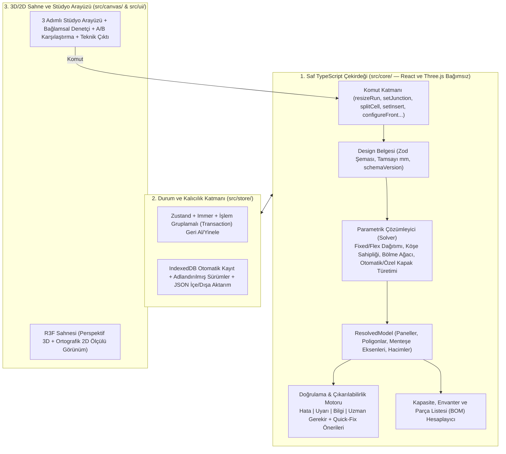
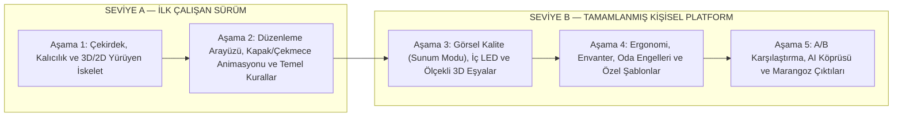

# Wardrobe Studio — Nihai Proje ve Mimari Ana Planı (Master Plan)

> **Belge Statüsü:** Uygulamaya Esas Nihai Ana Plan (Tek Gerçek Kaynak)  
> **Koordinatör:** Gemini 4 Argon (Ana Koordinatör & Baş Mimar)  
> **Kaynak Belgeler:** `implementation_plan_gemini.md`, `bagimsiz_arastirma_ve_plan_claude.md`, `gemini_review_of_claude.md`, `claude_final_audit_of_gemini_review.md`  
> **Tarih:** 28.10.2026

---

## 1. Kısa Yönetici Özeti ve Ürün Vizyonu

### 1.1 Ürün Vizyonu
**Wardrobe Studio**, ilk hedef olarak anne ve babanın ortak kullanacağı **L şeklindeki gömme gardırobu** gerçek ölçüler, mekanik kurallar, kişisel ergonomi ve özel depolama ihtiyaçlarına (dar ütü masası/katlanır merdiven nişi, beşgen/kör köşe, yüklük, çekmece ve askı kombinasyonları) göre tasarlamak; uzun vadede ise düz, L ve U tipi farklı dolap sistemlerini destekleyen genel amaçlı bir **3D Parametrik Gardırop Tasarım Platformu** oluşturmak üzere kurgulanmıştır.

### 1.2 Temel Mühendislik Felsefesi: Yüksek Kalite, Makul Karmaşıklık
1. **Gerçeğin Tek Kaynağı Tasarım Belgesi ve Saf Çözümleyicidir:** Uygulamanın kalbi 3D sahne değil, milimetrik niyet bildiren `Design` JSON belgesi ve bu belgeyi panellere, kapaklara, iç hacimlere, kapasite metriklerine ve doğrulama uyarılarına dönüştüren **Saf TypeScript Çözümleyicidir (`Solver`)**. 3D görüntüleyici, 2D teknik görünüm ve parça listesi hiçbir matematiksel hesap yapmadan bu çözülmüş modeli çizer.
2. **Sıfır Gereksiz Altyapı:** İlk iki ürün seviyesinde sunucu (backend), kullanıcı hesabı, bulut veritabanı, ağır WASM CAD çekirdeği (`OpenCascade`), boolean CSG kütüphanesi veya fizik motoru (`Rapier`) kullanılmaz. Tüm veriler tarayıcıda (`IndexedDB`) ve taşınabilir `.json` dosyalarında güvenle saklanır.
3. **Kademeli Teslimat:** Bütün özellikler tek bir dev sürüme sıkıştırılmaz. Önce günlük kullanımda gerçek tasarım yapılabilen **Seviye A (İlk Çalışan Sürüm)** tamamlanır, ardından anne ve babanın nihai gardırop tasarımını eksiksiz çıkaracak **Seviye B (Tamamlanmış Kişisel Tasarım Platformu)** aşamalı olarak inşa edilir.

---

## 2. Ürün Kapsamı: Üç Seviyeli Geliştirme Modeli

Özellikler; **"Kaldırma"** (hiç hazırlık yapmama) ile **"Erteleme"** (veri modelinde yerini ayırıp arayüzünü ilgili seviyede yazma) ayrımı korunarak üç seviyeye ayrılmıştır:

| Özellik / Yetenek Alanı | Seviye A: İlk Çalışan Sürüm (ÇS) | Seviye B: Tamamlanmış Kişisel Platform (KP) | Seviye C: Genel Platform (v2+) |
| :--- | :--- | :--- | :--- |
| **Gövde & Duvar Yapısı** | Düz (I) ve L şekli; `fixed(mm) \| flex(weight)` ölçü dağıtımı ve kilit (`locked`); asimetrik kol derinliği (`depthA ≠ depthB`); baza, üst taç ve yan duvar dolguları. | Oda engelleri (yatak, oda kapısı, pencere, radyatör, priz/anahtar) ve duvar nem/küf uyarıları. | U-şekli ve ada (island) arayüzü (veri modeli Seviye A'da hazır), eğimli tavan kesimleri. |
| **Köşe Birleşimleri (`Junction`)** | **1) Kör Köşe** (kör klapa + iki ayrı kapak), **2) Beşgen / Diyagonal Köşe** (2D poligon ekstrüzyon raflar + açılı tek kapak). | **Kademeli L-Askı** ve **Kör Köşe Valiz/Yüklük** iç şablonları; donanım doğrulamasına bağlı **Katlanır (Bi-Fold) L-Köşe Kapağı**. | Döner karusel / sihirli köşe mekanizmaları, yürüyüşlü (walk-in) köşe odası. |
| **İç Bölme & Modüller** | Özyinelemeli `SplitNode` ağacı + `InsertRegistry`: sabit/ayarlı raf, askı borusu (kısa/orta/uzun/çift), çekmece takımı (iç/dış), ayakkabılık, üst yüklük, **dar dikey servis nişi** (merdiven/ütü masası/süpürge). | Türk evi derin "Yüklük" (yorgan/nevresim) şablonu, bölmeli takı/aksesuar çekmecesi, pantolonluk, kirli sepeti, bölme kopyalama ve simetrik yansıtma. | Pantograf (inen askı) kol animasyonu, kapak arkası aksesuarlar, serbest çokgen raflar. |
| **Kapak (`Front`) & Animasyon** | Bağımsız `Front` katmanı + bölmeden otomatik türetilen varsayılan menteşeli kapaklar, dış çekmeceler ve açık bölmeler; `@react-spring/three` yay animasyonu; iç çekmece tıklamasında önce kapağı açma; X-Ray / kapak gizleme. | Zeminde kapak/çekmece **2D Süpürme Alanı (`Swept Area`)** gösterimi; kullanıcı tercih ederse **Sürgülü Kapak**. | Kalkar (makaslı) kapak, kapak içi ayna/aksesuar. |
| **Görsel Kalite & Eşyalar** | Temel PBR malzemeler, dünya-ölçeğinde UV ve doğru ahşap damar yönü (`grainAxis`), IBL + yönlü gölge, 3D yörünge kamera + **2D Ortografik Ölçülü Ön Görünüş / Plan**. | **Sunum Modu** (hedef cihazda doğrulanmış `N8AO` + `ContactShadows`), cam/ayna/metal, **Dolap İçi LED Aydınlatma**, `InstancedMesh` ile **gerçek ölçülü 3D iç eşyalar** (askıda giysiler, kutular, ayakkabılar, katlanır merdiven, ütü masası, valiz). | GPU Path-Tracing fotoğraf modu, WebGPU, sıkıştırılmış glTF kıyafet paketleri, AR görünümü. |
| **Kişiselleştirme & Doğrulama** | Kapak-çekmece ve L-köşe kulp çarpışması, raf sehim ve askı derinliği uyarıları, **dar niş eşya sığma ve çıkarılabilirlik kontrolü**. | **Anne & Baba İki Kişilik Ergonomi Profili** + Göz Hizası Kameraları + Sahiplik (`Anne \| Baba \| Ortak`) renklendirmesi + **Envanter Kapasite Sayacı** + "Neden?" açıklamalı hızlı düzeltmeler (`Quick-Fix`). | Kullanım sıklığı simülasyonu, envanterden otomatik yerleşim optimizasyonu. |
| **Kayıt, Karşılaştırma & Çıktı** | Komut + anlık görüntü tabanlı Geri Al/Yinele, **IndexedDB otomatik kayıt**, `.json` dışa/içe aktarım, `schemaVersion` kontrolü. | **Adlandırılmış Sürümler (Snapshots) + Yan Yana Kapasite/Ölçü Fark Tablosu (Hafif A/B)**, dış AI (Claude/Gemini) JSON tasarım köprüsü, **2D Ölçülü Teknik Çizim (SVG/PDF) + CSV Parça Listesi**. | Uygulama içi LLM asistanı, plaka kesim optimizasyonu, CNC (`.dxf/.mpr`), çok kullanıcılı bulut. |

---

## 3. Nihai Teknoloji ve Mimari Kararları

### 3.1 Teknoloji Yığını
- **Uygulama Çatısı ve Dil:** `Vite` (SPA) + `React 19` + `TypeScript (strict mode)` + `Tailwind CSS` + `Lucide Icons`.
- **3D ve Sahne Katmanı:** `Three.js` (`WebGLRenderer`) + `React Three Fiber (R3F)` + `@react-three/drei`. *(İlk sürümlerde ekosistem uyumu ve kararlılık için WebGL kullanılır; malzeme tanımları tek bir `materialRegistry` altında soyutlanır).*
- **Animasyon:** `@react-spring/three` (kesilebilir, yarıda yön değiştirebilen yay fiziği; R3F yeniden çizim döngüsüyle entegre).
- **Görsel Efektler (Seviye B Sunum Modu):** `@react-three/postprocessing` (`N8AO`) ve `ContactShadows` *(Aşama 3 başında hedef bilgisayarda yapılacak performans doğrulamasıyla varsayılan parametreleri kesinleştirilir)*.
- **Durum, Geçmiş ve Şema:** `Zustand` + `Immer` + `Zod` (çalışma zamanı doğrulama ve şema sürümü) + Komut & Anlık Görüntü (`Snapshot`) tabanlı Geri Al/Yinele.
- **Veri Saklama ve Test:** `idb-keyval` (veya hafif `IndexedDB` sarmalayıcı) + JSON dosya içe/dışa aktarım; birim testler için `Vitest`.

### 3.2 Katmanlı Yazılım Mimarisi

### 3.3 Temel Veri Modeli Kuralları
1. **Tamsayı Milimetre (`Integer mm`) Sözleşmesi:** Tasarım belgesindeki ve çözülmüş modeldeki tüm ölçüler tamsayı milimetredir. `flex` ağırlıklı ölçü dağıtımlarında oluşan küsuratlar `Math.round` ile yuvarlanır ve kalan `±1..2 mm` fark son esnek bölmeye eklenir (`remainder distribution`). Metreye dönüşüm (`× 0.001`) yalnızca R3F render sınırında yapılır.
2. **Kol ve Birleşim Grafiği (`Run[] + Junction[]`):**
   - Her duvar kolu (`Run`); başlangıç noktası, doğrultusu, toplam uzunluğu, dış derinliği (`depth`), yüksekliği, baza/üst taç parametreleri ve içindeki gövde bölmeleri (`Bay[]`) ile tanımlanır.
   - Köşe birleşimi (`Junction`); `runA` ve `runB` uçlarını bağlar, köşe tipini (`blind | diagonal | ...`) ve her iki koldan tükettiği milimetrik payı belirler. Böylece bir kolun derinliği `600 mm`, diğerinin `450 mm` olduğunda köşe modülü her iki derinliğe otomatik uyum sağlar.
3. **Eklenti Kaydı (`InsertRegistry`):** Karmaşık bir dış eklenti mekanizması yerine, `src/core/inserts/` altında her iç modül tipinin (raf, askı, çekmece, dar servis nişi, ayakkabılık, yüklük) parametre şemasını, varsayılanlarını, panel/geometri üreticisini, kapasite formülünü ve özel kurallarını tek bir tiplenmiş nesnede toplayan yalın bir kayıt tablosu kullanılır.

---

## 4. Parametrik Modelleme, 3D Görüntüleme ve Animasyon Stratejisi

### 4.1 Geometri Üretimi ve Dünya-Ölçeğinde UV
- **Kutu Paneller (`BoxPanel`):** Dikmeler (18/25 mm), düz raflar, çekmece parçaları, bazalar ve düz kapaklar gerçek `(genişlik, yükseklik, kalınlık)` milimetre değerleriyle oluşturulur. Hiçbir parça `mesh.scale` ile sündürülmez.
- **Poligon Paneller (`PolygonPanel`):** Beşgen/diyagonal köşe modülünün alt/üst tablaları ve beşgen rafları 2D köşe koordinatlarından `THREE.Shape` $\rightarrow$ `ExtrudeGeometry` ile üretilir.
- **Doku ve Suyolu (`grainAxis`):** Ahşap dokuların panel büyüdükçe uzamaması için UV koordinatları dünya ölçeğinde (milimetre bazlı) hesaplanır; dikmelerde ve kapaklarda dikey, raflarda yatay damar yönü uygulanır. Çakışık düzlemlerde Z-fighting'i önlemek için `0.1 mm` görsel ofset kullanılır.

### 4.2 Bağımsız Kapak (`Front`) Katmanı ve Otomatik Türetim
- **Veri Modeli:** Kapaklar gövde bölmelerinden (`Bay`) bağımsız bir katmandır (`spanBays`, `yRange`, `hingeSide`, `openingAngleType`, `handle`). Bu sayede iki dar bölme tek kapakla örtülebilir veya alt kısım dış çekmece iken yalnızca üst kısma kapak takılabilir.
- **Kullanım Kolaylığı (Otomatik Varsayılanlar):** Kullanıcı her kapağı sıfırdan tanımlamak zorunda değildir. Her bölme varsayılan olarak `autoFront: true` modundadır (bölme genişliği `≤ 600 mm` ise tek kapak, `> 600 mm` ise çift kapak otomatik üretilir; dış çekmece eklendiğinde kapak alt sınırı `yRange` otomatik yukarı çekilir). Kullanıcı yalnızca özel birleştirme veya yön değişimi istediğinde kapak ayarına müdahale eder.

### 4.3 Kinematik Hareket ve Animasyon Kuralları
- **Menteşeli Kapaklar:** Gerçek menteşe pivot ekseni etrafında, seçilen menteşe tipinin açısına göre (`110°` standart, `155°` sıfır çıkıntılı, `165°` geniş açılı) `@react-spring/three` yay fiziğiyle açılır/kapanır.
- **Çekmeceler:** Kızak tipine göre (`0.80` kısmi veya `1.0` tam çekmeli) yerel Z ekseninde kayar.
- **Akıllı İç Çekmece Etkileşimi:** Menteşeli kapak arkasındaki bir iç çekmeceye tıklandığında, kapak kapalıysa önce kapak otomatik açılır, ardından çekmece dışarı kayar.
- **Render Döngüsü Uyumu:** Animasyonlar `@react-spring/three` üzerinden yürütülür; özel bir `useFrame` hareketi eklendiğinde `invalidate()` çağrısı zorunludur.

---

## 5. Kullanıcı Deneyimi (UX) ve Özelleştirme Sistemi

### 5.1 Yalın 3 Adımlı Çalışma Akışı ve Global Anahtarlar
Kullanıcıyı 6 farklı mod arasında kaybolmaktan kurtarmak için üst çubukta her an geçiş yapılabilen **3 ana çalışma adımı** yer alır:
1. **Oda & Gövde (L-Plan):** Kol uzunlukları, yükseklik, derinlikler, köşe tipi, sütun (`Bay`) genişlikleri (`fixed / flex` ve kilit) ile Seviye B'deki oda engelleri ve ergonomi profilleri.
2. **İç Düzen & Kapaklar:** Hücre bölme (`SplitNode`), modül atama (`InsertRegistry`), özel servis nişleri, kapak/çekmece düzeni ve canlı doğrulama uyarıları.
3. **Malzeme, Sunum & Çıktı:** Gövde/kapak/kulp/LED seçimleri, iç eşya doluluk önizlemesi, A/B sürüm karşılaştırma ve ölçülü teknik çıktı.

**Her Adımda Erişilebilir Alt/Üst Hızlı Anahtarlar:**
- `Görünüm: 3D Perspektif | 2D Ölçülü Ön Görünüş | 2D Üstten Plan`
- `Kapaklar: Kapalı | Açık | Yarı Saydam (X-Ray) | Gizli`
- `İç Eşyalar: Göster / Gizle` *(Seviye B)*
- `Geri Al / Yinele` ve `Sürüm Kaydet (Snapshot)`

### 5.2 Doğrudan Seçim + Bağlamsal Denetçi (Inspector)
- İlk sürümde hata üretmeye açık serbest 3D fare sürükleme (drag-gizmo) yerine; **3D veya 2D sahnede hücre hacmine tıklama $\rightarrow$ Sağ Bağlamsal Denetçiden (Inspector) Hızlı Böl ("Dikey Böl", "Yatay Böl"), Hazır Şablon Uygula veya Sayısal/Kaydırıcı ile Ölçü Değiştir** akışı kullanılır.
- Sabit paneller `1 mm` hassasiyetle (varsayılan `10 mm` ok tuşu adımıyla), ayarlı raf delikleri ise `32 mm` sistem adımıyla düzenlenir.

---

## 6. Özel Depolama, Köşe Modelleri ve Fiziksel Doğrulama Yaklaşımı

### 6.1 L-Köşe Stratejisi
1. **Kör Köşe (`blind` — Seviye A):** Bir kol köşeye kadar uzanır, diğer kol parametrik bir **Kör Klapa (`cornerFiller`: ör. 50–70 mm)** ile ona dik yanaşır. Ön cephesinde iki ayrı menteşeli kapak bulunur; derin arka bölge valiz/mevsimlik eşya veya **Kademeli L-Askı** (bir kolda kısa askı, diğer kolda raf/çekmece ile boru çakışmasını önleyen şablon — Seviye B) için kullanılır.
2. **Beşgen / Diyagonal Köşe (`diagonal` — Seviye A):** Sol ve sağ duvar genişlikleri (ör. `900×900 mm`) ile komşu kolların derinliklerini (`depthA`, `depthB`) birleştiren 5 kenarlı gövde, önde açılı tek kapak ve içeride poligon ekstrüzyonla üretilen beşgen raflar veya askı alanı sunar.
3. **Katlanır Kapaklı L-Poligon Köşe (`biFold` — Seviye B Doğrulamalı):** Yalnızca donanım uygunluğu ve kinematik prototip doğrulamasından geçerse Seviye B'nin son aşamasında eklenir; ilk çalışan sürümün ön koşulu değildir.

### 6.2 Dar Dikey Servis Nişleri İçin Eşya Tabanlı Sığma ve Çıkarılabilirlik Kontrolü
Ütü masası ve katlanır merdiven gibi özel eşyalar için rastgele bir sabit minimum genişlik (ör. 160 mm veya 300 mm) dayatılmaz. Bunun yerine nişe atanan **hedef eşyaların gerçek ölçülerine (`w × d × h`) dayalı 3 adımlı geometrik kontrol** uygulanır:
1. **Statik İç Sığma:** Eşyanın seçilen yönelimdeki genişliği + varsa aynı nişteki ikinci eşya genişliği + **el/tutma payı (`varsayılan 30–50 mm`)** $\le$ Hücre Net İç Genişliği (`cellNetWidth`). Aynı şekilde derinlik ve yükseklik (kancalı eşyada `+ kaldırma payı`) kontrol edilir.
2. **Etkin Kapak Açıklığından Çıkarılabilirlik:** Eşyanın ön kesit genişliği, kapak açıldığında oluşan **etkin açıklıktan** (`cellNetWidth - menteşeÇıkıntısı`) rahatça geçebilmelidir. Örneğin `220 mm` net genişlikli bir nişte `130 mm` merdiven + `90 mm` ütü masası yan yana konduğunda el payı `0 mm` kalır ve standart `110°` menteşe (`~22 mm` çıkıntı) eşyanın çıkarılmasını engeller; sistem bunu yakalar ve *"El payı yetersiz (0 mm, önerilen ≥30 mm) ve menteşe çıkıntısı geçişi daraltıyor. Nişi 35 mm genişletin veya 155° sıfır çıkıntılı menteşe seçin"* şeklinde **Hızlı Düzeltme (`Quick-Fix`)** önerir.

### 6.3 Doğrulama Kuralları ve Uzman Sınırı
Tüm eşikler `validationConfig` içinde yapılandırılabilir sabitler olarak tutulur ve uyarılar **4 önem derecesiyle** (`Hata`, `Uyarı`, `Bilgi`, `Uzman Doğrulaması Gerekir`) sunulur:
- **Yazılımın Denetlediği Kurallar:** Parça/hücre çakışmaları, menteşeli kapak kenarının dikmeye oturması, kapak genişliği (`>600 mm` uyarı), L-köşe kapak/çekmece/kulp süpürme kesişimi, menteşeli kapak arkasındaki iç çekmece için çıta/sıfır çıkıntılı menteşe kontrolü, raf açıklığı sehim uyarısı (`18 mm` için `>850 mm`), önden askı için minimum net derinlik (`<530 mm` uyarı) ve eşya sığma/çıkarılabilirlik.
- **"Uzman Doğrulaması Gerekir" Etiketli Konular:** Duvar gönyesizliği ve terazi sapmaları (röleve/scribing), dış duvara bitişik dolaplarda nem/küf için havalandırma boşluğu, gerçek menteşe/kızak katalog delik ölçüleri, ağır yük taşıyıcılığı ve duvara sabitleme.

---

## 7. Görsel Kalite Hedefleri ve Doğrulama Yöntemi

Ölçüm yapılmadan ezbere FPS veya milisaniye garantisi verilmez. Görsel kalite ve akıcılık şu stratejiyle yönetilir:
1. **İki Kalite Kipinin Ayrılması:**
   - **Düzenleme Modu (Varsayılan, Seviye A'dan itibaren):** Temiz PBR malzemeler, doğru ahşap damar yönü, belirgin panel kenar çizgileri, IBL ortam aydınlatması ve hafif yönlü gölge. Günlük tasarımda en yüksek tepkiselliği sağlar.
   - **Sunum Modu (Seviye B):** `N8AO` (ekran-uzayı ortam kapatma ile raf ve köşe içlerinde derinlik gölgesi), `ContactShadows` ve **Dolap İçi LED Şerit Aydınlatma** (`emissive` şerit + kol başına en fazla 1 hafif iç ışık kaynağı).
2. **Hedef Cihazda Görsel Doğrulama Testi (Aşama 3 Başlangıcı):**
   - Sunum modu efektleri (`N8AO`, `ContactShadows`, X-Ray saydamlığı ve LED ışık) eklendiğinde, kullanıcının bilgisayarı üzerinde kapak animasyonu çalışırken kare süresi (`frame time`) ve görsel kalite test edilir; `ContactShadows` güncelleme sıklığı ve AO çözünürlüğü bu gerçek ölçüme göre sabitlenir.

---

## 8. Veri Saklama ve Tasarım Dosyası Yönetimi

Kullanıcının tasarım emeğinin hiçbir koşulda kaybolmaması için kalıcılık **Aşama 1'de** kurulur:
- **Otomatik Yerel Kayıt (`IndexedDB`):** Her komut sonrasında (kaydırıcı sürüklemelerinde işlem tamamlandığında / `debounce` ile) aktif tasarım belgesi `IndexedDB` üzerine otomatik kaydedilir. Tarayıcı kapansa veya sayfa yenilense bile son durum anında geri yüklenir.
- **Taşınabilir Dosya (`.wardrobe.json`):** Kullanıcı tasarımını istediği an JSON dosyası olarak bilgisayarına indirebilir ve geri yükleyebilir.
- **Yalın Şema Sürümü (`schemaVersion`):** Belge kökünde `schemaVersion: 1` alanı yer alır. İçe aktarılan her dosya `Zod` şemasından geçer; henüz var olmayan geçmiş sürümler için karmaşık göç (migration) katmanları yazılmaz, yalnızca eksik isteğe bağlı alanlara varsayılan değer atayan (`normalizeDesign`) yalın bir koruma fonksiyonu bulunur.
- **İşlem Gruplamalı (Transaction) Geçmiş:** Kaydırıcı (slider) sürüklenirken oluşan onlarca ara değişim tek bir geri alma adımında (`commit`) birleştirilir; en az 50 adımlık okunabilir komut geçmişi tutulur.

---

## 9. Aşamalı Geliştirme Yol Haritası ve Kabul Kriterleri

Geliştirme süreci, ayrı ve atıl prototip projeleri oluşturmadan, her aşaması doğrudan nihai ürüne dönüşen **5 net aşamada** yürütülecektir. **Aşama 1 ve 2 sonunda Seviye A (İlk Çalışan Sürüm)**, **Aşama 3, 4 ve 5 sonunda Seviye B (Tamamlanmış Kişisel Platform)** teslim edilir:

### Aşama 1 — Çekirdek Veri Modeli, Çözümleyici, Kalıcılık ve 3D/2D Yürüyen İskelet
- **Amaç:** Proje kurulumunu tamamlamak, saf TS çözümleyiciyi (`Run + Junction`, `fixed/flex`, `SplitNode`, kör ve beşgen köşe poligon matematiği) birim testleriyle doğrulamak, `IndexedDB` + JSON kaydını ilk günden devreye almak ve çözülmüş modeli 3D + 2D ortografik sahnede görselleştirmek.
- **Kullanıcıya Görünür Çıktı:** Tarayıcıda açılan, düz ve L-gardırop (kör köşe ve beşgen köşe, asimetrik kol derinliği dahil) örneklerini 3D perspektif ve 2D ölçülü ön görünüşte hatasız çizen, JSON olarak dışa/içe aktarabilen ve sayfa yenilendiğinde durumu koruyan çalışan uygulama iskeleti.
- **Doğrulama ve Kabul Kriterleri:**
  1. `npm run dev`, `npm test` ve `npm run build` sıfır hatayla çalışmalı.
  2. Düz, L-kör köşe ve L-beşgen köşe (farklı derinlikli kollar dahil: ör. `600 mm` ve `450 mm`) panelleri 3D sahnede boşluksuz ve iç içe geçmeden oluşmalı.
  3. `800 mm` dış genişlikli bir bölmede iki yan dikme (`2 × 18 mm`) düşülerek net iç genişliğin `764 mm` olduğu ve `fixed/flex` dağıtımında kilitli bölmelerin korunduğu `Vitest` birim testleriyle doğrulanmalı.
  4. Sayfa yenilendiğinde veya JSON dışa/içe aktarıldığında tasarım birebir aynı kalmalı.
- **Sonraya Bırakılanlar:** Zengin düzenleme panelleri, kapak animasyonları, gelişmiş gölgelendirme ve iç eşyalar.

### Aşama 2 — Etkileşimli Düzenleme Arayüzü, Kapak/Çekmece Animasyonları ve Temel Kurallar *(SEVİYE A TESLİMİ)*
- **Amaç:** Kullanıcının kendi L-gardırobunu sıfırdan oluşturup özelleştirebildiği, kapak ve çekmeceleri açıp kapatabildiği ve temel mühendislik/sığma uyarılarını görebildiği **İlk Çalışan Sürümü (Seviye A)** tamamlamak.
- **Kullanıcıya Görünür Çıktı:** 3 adımlı stüdyo arayüzü, sol yapı ağacı, sağ bağlamsal denetçi (Inspector), hücre bölme (`Dikey/Yatay Böl`), temel modül kataloğu (raf, askı, çekmece, ayakkabılık, üst yüklük, dar dikey servis nişi), tıklamayla yay animasyonlu açılan menteşeli kapaklar ve çekmeceler, X-Ray görünümü, işlem gruplamalı Geri Al/Yinele ve temel doğrulama paneli.
- **Doğrulama ve Kabul Kriterleri:**
  1. Kullanıcı boş projeden başlayarak beşgen veya kör köşeli, içinde dar merdiven/ütü masası nişi, çekmece ve askılık bulunan bir L-gardırobu baştan sona tasarlayabilmeli.
  2. Kapaklar menteşe tipine uygun açıyla doğru pivotta açılmalı; kapalı kapak arkasındaki iç çekmeceye tıklandığında önce kapak açılmalı.
  3. Dar nişe yerleştirilen merdiven/ütü masası için **el payı ve menteşe çıkıntısı (çıkarılabilirlik)** kuralı, kapak-çekmece çakışması ve L-köşe kulp çarpışması kuralları pozitif/negatif testlerle doğrulanmalı.
- **Sonraya Bırakılanlar:** `N8AO`/Sunum modu, iç LED, 3D kıyafet/eşya modelleri, oda engelleri, ergonomi ısı haritası ve marangoz çıktıları.

### Aşama 3 — Görsel Gerçekçilik (Sunum Modu), İç LED Aydınlatma ve Ölçekli 3D Eşyalar *(SEVİYE B - Adım 1)*
- **Amaç:** Görsel kaliteyi üst seviyeye taşımak ve gardırop içi depolama alanlarının gerçek eşyalarla nasıl göründüğünü 3D olarak deneyimlemek.
- **Kullanıcıya Görünür Çıktı:** Zenginleştirilmiş malzeme kataloğu (ahşap dokular, mat/parlak lake, cam, ayna, metal), hedef cihazda doğrulanmış **Sunum Modu** (`N8AO` iç köşe gölgeleri + `ContactShadows`), **Dolap İçi LED Şerit Aydınlatma** anahtarı ve `InstancedMesh` tabanlı **gerçek ölçülü 3D iç eşya simülasyonu** (askıda kısa/uzun kıyafetler, katlı giysiler, standart kutular/hurçlar, ayakkabılar, katlanır merdiven, ütü masası, valiz).
- **Doğrulama ve Kabul Kriterleri:**
  1. Panel ölçüleri değiştiğinde ahşap dokusu sünmemeli; dikmelerde dikey, raflarda yatay suyolu yönü korunmalı.
  2. Hedef bilgisayarda Düzenleme ve Sunum modları ile X-Ray görünümü test edilerek kapak animasyonlarını aksatmayan görsel kalite parametreleri sabitlenmeli.
  3. "İç Eşyaları Göster" açıldığında dar nişte gerçek ölçülü merdiven/ütü masası, askılarda ve raflarda hücre ölçüsüne uygun sayıda kıyafet ve kutu doğru konumda görünmeli.

### Aşama 4 — Anne & Baba Ergonomisi, Envanter Sayacı, Oda Engelleri ve Yaratıcı Şablonlar *(SEVİYE B - Adım 2)*
- **Amaç:** Tasarımı anne ve babanın fiziksel ölçülerine, gerçek eşya sayılarına ve yatak odası yerleşimine tam uyumlu hâle getirmek.
- **Kullanıcıya Görünür Çıktı:** Anne ve baba boy profili girişi, 2D/3D erişim bölgeleri ısı haritası, **Anne/Baba Göz Hizası Kamera** ön ayarları, bölme sahiplik etiketleri (`Anne | Baba | Ortak`), canlı **Envanter Kapasite Sayacı**, oda engelleri (yatak, kapı, pencere, radyatör, priz) + zeminde **2D Kapak/Çekmece Süpürme Alanı (`Swept Area`)**, Türk evi "Yüklük" ve "Kademeli L-Askı" şablonları, bölme kopyalama/yansıtma ve "Neden?" açıklamalı **Hızlı Düzeltme (`Quick-Fix`)** butonları.
- **Doğrulama ve Kabul Kriterleri:**
  1. Anne veya babanın boy ölçüsü değiştirildiğinde erişim bölgeleri ve yüksek askı/raf uyarıları canlı güncellenmeli.
  2. Gardırop önüne yerleştirilen bir yatak veya oda kapısı engeli, açılan kapak yayı ile kesiştiğinde zeminde ve uyarı listesinde açıkça gösterilmeli.
  3. Girilen hedef envanter sayıları ile modüllerin hesaplanan kapasitesi tutarlı biçimde karşılaştırılmalı.

### Aşama 5 — A/B Tasarım Karşılaştırma, Dış AI Köprüsü ve Ölçülü Marangoz Çıktıları *(SEVİYE B TAMAMLANIŞI)*
- **Amaç:** Farklı tasarım alternatiflerini karşılaştırıp nihai kararı vermek ve marangoza/ustaya götürülebilecek teknik çıktıları üretmek.
- **Kullanıcıya Görünür Çıktı:** Adlandırılmış sürümler (Snapshots) ve **Yan Yana Kapasite/Envanter/Ölçü Fark Tablosu (Hafif A/B Karşılaştırma)**, dış yapay zekâ modelleriyle (Claude/Gemini) konuşmak için **"AI İstem Kopyala / JSON Varyant Yükle"** köprüsü, yazdırılabilir **2D Ölçülü Teknik Çizim (SVG/PDF)**, **CSV Parça/Kesim Listesi** ve **"Uzman Doğrulaması Gerektiren Noktalar"** raporu *(ayrıca kullanıcı tercih ederse sürgülü kapak veya doğrulanmış katlanır köşe kapağı)*.
- **Doğrulama ve Kabul Kriterleri:**
  1. İki farklı tasarım sürümü arasında kapasite (askı metresi, çekmece hacmi, raf alanı, envanter karşılama) ve parça farkları tek tabloda karşılaştırılabilmeli; dışarıdan yapıştırılan JSON varyantı `Zod` ile doğrulanıp yeni sürüm olarak açılabilmeli.
  2. Üretilen 2D teknik çizimdeki ve CSV parça listesindeki tüm ölçüler çözümleyici (`Solver`) değerleriyle milimetresine kadar birebir örtüşmeli.

---

## 10. Test ve Kalite Kontrol Stratejisi

1. **Çekirdek Birim Testleri (`Vitest`):**
   - `fixed/flex` ölçü dağıtımı ve kalan milimetre yuvarlaması,
   - Düz, L-kör köşe ve L-beşgen köşe (asimetrik derinlikli) panel koordinat ve net iç ölçü hesapları,
   - Dar servis nişi eşya sığma ve kapak açıklığından çıkarılabilirlik matematiği,
   - Kapak-çekmece, L-köşe kulp ve oda engeli 2D süpürme alanı kesişim kuralları,
   - JSON dışa/içe aktarım ve `schemaVersion` doğrulama testleri tarayıcısız olarak otomatik koşulur.
2. **Görsel ve Etkileşim Doğrulaması:**
   - Her aşama sonunda 3D perspektif, 2D ortografik ölçülü ön görünüş, kapak/çekmece açılma eksenleri ve X-Ray görünümü gerçek tasarım senaryoları üzerinde kontrol edilir.

---

## 11. Ertelenen Özellikler ve Gereksiz Mühendislikten Kaçınma Kararları

Geliştirme enerjisini doğrudan ürün kalitesine odaklamak için şu unsurlar **kesin olarak kapsam dışı bırakılmış veya Seviye C'ye ertelenmiştir**:
- **Reddedilenler (Hiçbir Hazırlık Yapılmayacaklar):** `OpenCascade` / WASM CAD çekirdekleri, `three-bvh-csg` (boolean CSG), `Rapier` fizik motoru, kumaş fiziği (cloth simulation), `AccumulativeShadows` (hareketli kapaklarla çeliştiği için).
- **Seviye C'ye (v2+) Ertelenenler:** Çok kullanıcılı sunucu/bulut ve kimlik doğrulama, uygulama içi ücretli LLM API bağlantısı, CNC makinesi delik/kesim dosyaları (`.dxf/.mpr`), plaka kesim optimizasyonu, döner karusel ve pantograf mekanizmaları, GPU path-tracing fotoğraf modu, WebGPU ve AR görünümü.

---

## 12. Açık Kalan Kullanıcı Tercihleri ve Geçici Varsayımlar

Kullanıcıyı yeni bir soru-cevap döngüsüyle yormamak adına, açık kalan konularda şu **güvenli geçici varsayımlar** kabul edilmiştir (kullanıcı istediği an değiştirebilir):

| Konu | Geçici Varsayım (Aksi Belirtilmedikçe Uygulanacak Karar) |
| :--- | :--- |
| **1. Çalışma Klasörü Konumu** | Mevcut `c:\Users\cagri\OneDrive\Resimler\Masaüstü\Wardrobe-Studio` dizini kullanıcı onayı olmadan **taşınmayacaktır**. *(Not: Kişisel OneDrive'da `node_modules` senkronizasyonu dosya kilitlemelerine yol açabildiği için, geliştirme başlarken kullanıcı isterse projeyi `C:\dev\wardrobe-studio` gibi OneDrive dışı bir yola taşıyabiliriz; istemezse mevcut dizinde devam edilir).* |
| **2. Sürgülü Kapak Tercihi** | Gömme L-gardıropta birincil odak **menteşeli kapaklar ve dış/iç çekmecelerdir**. Sürgülü kapak veri modelinde (`Front`) desteklenecek, ancak arayüzü yalnızca kullanıcı gerçek gardırobunda sürgülü kapak düşündüğünü belirtirse Aşama 5'te eklenecektir. |
| **3. Marangoz Çıktılarının Yeri** | Temel 2D ölçülü ön görünüş Aşama 1–2'de (Seviye A) ekranda yer alacak; yazdırılabilir SVG/PDF teknik pafta ve CSV kesim listesi Aşama 5'te (Seviye B) tamamlanacaktır. |
| **4. Hedef Bilgisayar Donanımı** | Kesin FPS sayıları taahhüt edilmemiştir; Aşama 3 başında kullanıcının mevcut bilgisayarında `Düzenleme` ve `Sunum` kalite kipleri test edilerek en akıcı ayarlar varsayılan yapılacaktır. |
| **5. Gerçek Oda ve Dolap Ölçüleri** | Henüz istenmemektedir. Platform geliştirilirken gerçekçi varsayılan L-gardırop şablonları (ör. `2800 × 2200 × 2400 mm`) kullanılacak; uygulama tamamlandığında anne ve babanın gerçek oda ölçüleri doğrudan arayüzden girilecektir. |

---

## 13. İlk Geliştirme Aşamasına (Aşama 1) Geçiş Hazırlığı

Kullanıcı onay verdiğinde başlatılacak **ilk somut görev (Aşama 1)** şunları kapsar:
1. `Vite + React + TypeScript (strict) + Tailwind CSS + Three.js + R3F + drei + Zustand + Immer + Zod + Vitest` proje iskeletinin kurulması ve bağımlılık uyumunun doğrulanması.
2. `src/core/` altında tamsayı milimetre (`integer mm`) tabanlı `Design` Zod şemasının, `Run + Junction` (düz, kör köşe ve beşgen köşe, asimetrik derinlik dahil) çözümleyicisinin, `fixed/flex` ölçü dağıtıcısının ve `SplitNode` ağacının kodlanması ve `Vitest` birim testleriyle doğrulanması.
3. `src/store/` altında komut + anlık görüntü geçmişi (Undo/Redo), `IndexedDB` otomatik kayıt ve `.json` dışa/içe aktarım sisteminin devreye alınması.
4. `src/canvas/` altında çözülmüş modeli 3D perspektif ve 2D ortografik ölçülü ön görünüş olarak çizen ilk çalışan sahnenin ayağa kaldırılması.

---

## 14. Dört Araştırma Belgesinden Yapılan Önemli Değişikliklerin Karar Özeti

| Karar Alanı | Önceki Belgelerdeki Durum | Nihai Plandaki Kesin Karar ve Gerekçesi |
| :--- | :--- | :--- |
| **Ürün Kapsamı** | Tüm özellikler tek bir "v1" listesinde toplanmıştı (`GR-§7`, `C-§1.3`). | **Seviye A (İlk Çalışan Sürüm)**, **Seviye B (Kişisel Platform)** ve **Seviye C (Genel Platform)** olarak 3 katmana ayrıldı. |
| **İlk Aşamada 3D ve Kalıcılık** | Claude `A1`'i tamamen 3D'siz yapmayı önermiş (`C-§11`), Gemini ise `IndexedDB` kaydını son faza bırakmıştı (`G-§9`). | **Aşama 1'de** hem `IndexedDB` + JSON kalıcılığı hem de koordinat hatalarını anında gösteren **3D/2D yürüyen iskelet** birleştirildi. |
| **Ayrı Prototip Fazı (`F0/P1/P2`)** | Claude ayrı bir `F0` prototip aşaması önermişti (`claude_final_audit §9`). | Ayrı prototip projeleri kurmak yerine, köşe geometrisi doğrulaması **Aşama 1**'e, görsel kalite/performans ölçümü **Aşama 3** başlangıcına entegre edildi. |
| **Dar Dikey Servis Nişi Kuralı** | Claude `30–45 cm` tipik aralık vermiş (`C-§5.2`), Gemini sabit `160 mm` alt sınır önermişti (`GR-§5.3`). | Sabit sayı yerine **Eşya Tabanlı Sığma ve Çıkarılabilirlik Kontrolü** (eşya ölçüsü + el payı + menteşe çıkıntısı/kapak açıklığı) benimsendi (`Bölüm 6.2`). |
| **L-Köşe ve Asimetrik Derinlik** | Gemini "Kademeli Köşe"yi ayrı köşe tipi saymış ve katlanır kapağı zorunlu tutmuştu (`G-§5.2`, `GR-§5.4`). | Asimetrik derinlik (`depthA ≠ depthB`) tüm köşelerin doğal özelliği yapıldı; Seviye A'da **Kör Köşe + Beşgen Köşe** önceliklendirildi, katlanır kapak doğrulamaya bağlandı. |
| **Kapak (`Front`) Katmanı** | Gemini kapakları modüle bağlamış (`G-§4.2`), Claude tamamen bağımsız katman yapmıştı (`C-§3.3`). | Veri modelinde bağımsız `Front` katmanı kabul edildi, ancak kullanıcıyı yormamak için **bölmeden otomatik kapak türetimi (`autoFront`)** varsayılan yapıldı. |
| **Görsel Hat ve Performans İddiaları** | Belgelerde ölçülmemiş `"<0.5 ms"`, `"≥55 FPS"`, `"60 FPS"` garantileri ve `AccumulativeShadows` vardı. | Ölçülmemiş FPS vaatleri ve `AccumulativeShadows` kaldırıldı; **Düzenleme** ve **Sunum (`N8AO + ContactShadows + İç LED`)** modları ayrıldı. |
| **Dış AI Köprüsü** | Claude v1'de komut şeması (`C-§7.2`), Gemini tam JSON varyant aktarımı (`G-§6.3`) önermişti. | Seviye B'de daha basit ve sağlam olan **Tam JSON + Zod Doğrulama $\rightarrow$ Yeni Varyant & A/B Fark Tablosu** yaklaşımı seçildi. |
